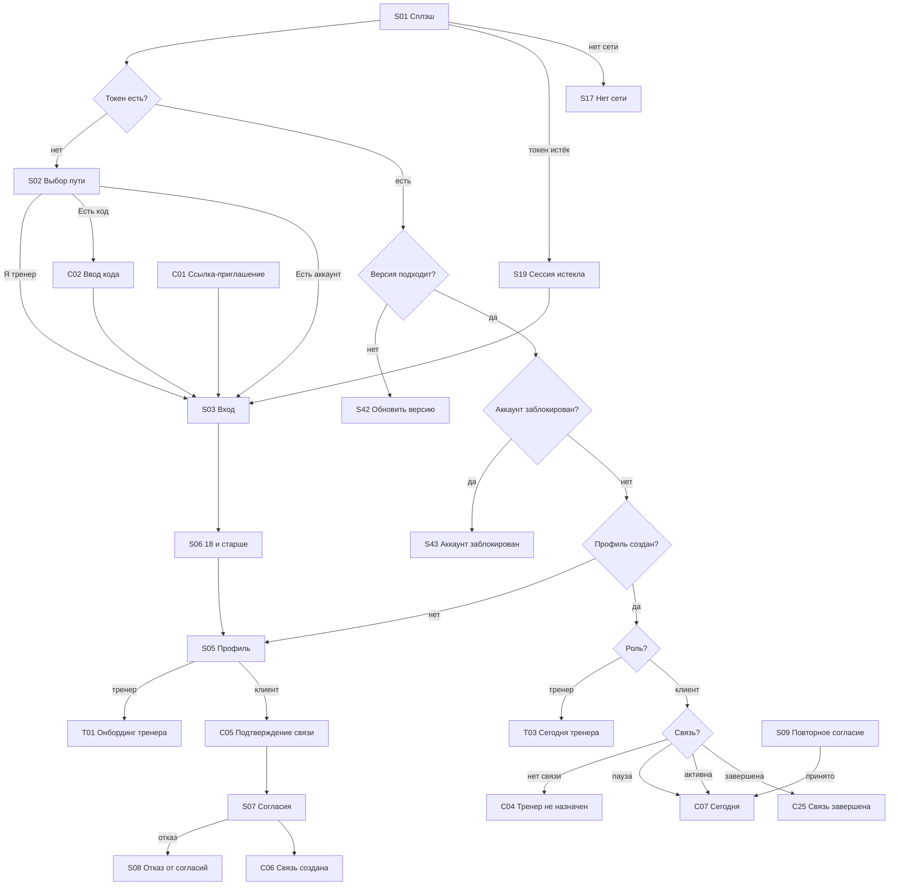
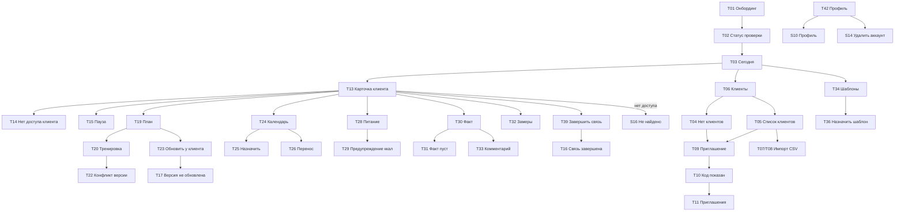
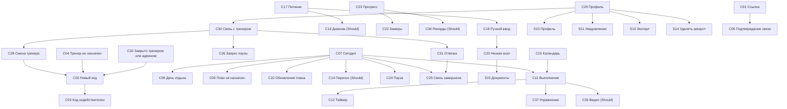

# 20. Карта экранов и навигации (MVP)

Дата: 2026-11-23. Основа: `00-validation.md` (решения O1–O8 приняты по рекомендациям, раздел 4 учтён полностью), `NoExcuse_MVP_Plan.md` (разделы 2 и 5), `noexcuse/CLAUDE.md` (разделы 6 и 8), ТЗ (раздел «Экраны MVP» и пользовательские пути), текущий код `apps/mobile`.

Статус: черновик для дизайна и декомпозиции. Всё, что зависит от O1–O8, помечено тегом `[O#]` и меняется одним правилом после решения владельца.

---

## 1. Принципы навигации

### 1.1 Технология и маршрутизация
- Expo Router, файловая маршрутизация. Группы маршрутов: `(auth)` (вход, согласия, онбординг), `(coach)`, `(client)`. Доступ по роли через `RoleGate` (как в текущем коде): чужая роль получает S16.
- Внутри вкладок: стек для детализации (клиент → план → блок → тренировка). Подтверждения и необратимые действия: модальное окно с явным текстом последствий.
- Ни один экран не читает данные напрямую из БД/хранилища: только через API (CLAUDE §6). Экраны с данными клиента проверяют связь и согласие на сервере; при отказе сервера (404) показывается S16 или специализированное состояние (C25, T38).

### 1.2 Нижняя панель клиента (5 вкладок)
| Вкладка | Экран | Что внутри |
|---|---|---|
| Сегодня | C07 | тренировка дня, цель КБЖУ, баннеры (пауза, обновления плана) |
| Календарь | C15 | неделя/месяц, переход к дню |
| Питание | C17 | план КБЖУ на день, ручной ввод |
| Прогресс | C23 | замеры и вес, график в Later |
| Профиль | C29 | профиль, связь с тренером (C30), уведомления, экспорт, удаление |

### 1.3 Нижняя панель тренера (4 вкладки)
| Вкладка | Экран | Что внутри |
|---|---|---|
| Сегодня | T03 | «Кому нужна реакция сегодня» |
| Клиенты | T06 | список клиентов со статусами; приглашение (T09) |
| Шаблоны | T34 | шаблоны (Should) |
| Профиль | T42 | профиль тренера, уведомления |

Календарь и план клиента открываются из карточки клиента (T13 → T24 / T19). Отдельной вкладки «Календарь» у тренера нет.

### 1.4 Планшет тренера: master-detail
- Ширина от 768 pt (константа в `packages/ui`): слева список клиентов T06, справа карточка T13 с вложенными T19/T24/T30 без ухода с экрана.
- Альбомная и портретная ориентация: та же структура, в портрете правая панель открывается поверх списка.
- Телефон: стек (T06 → T13 → …). Один код экранов, разные контейнеры.
- Клиентское приложение планшетного режима не имеет (узкий набор, см. [O8] и раздел 2).

### 1.5 Глубокие ссылки
| Маршрут | Экран | Примечание |
|---|---|---|
| `noexcuse://join` и `https://[домен уточнить]/join` | C01 | код приглашения передаётся во фрагменте (`#код`), фрагмент не уходит на сервер и не попадает в логи веб-хостинга |
| `/today` | C07 / T03 | по роли |
| `/calendar/:date` | C15 / T24 | дата `YYYY-MM-DD` |
| `/links/:id` | C30 | только свою связь; чужой id → S16 |
| `/clients/:id`, `/clients/:id/plan`, `/clients/:id/calendar/:date` | T13, T19, T24 | чужой клиент → S16 |
| `/notifications/:type` | S11 | из push; текст push без PII (CLAUDE §9) |

Правила: ссылка до входа сохраняется как намерение, после S03 возвращает на маршрут. Ссылка, не соответствующая роли или связи, ведёт на S16 или на домашний экран роли, без подсказок о существовании ресурса.

### 1.6 Статусы, тексты и доступность
- Статус не только цветом. Каждый статус = цвет + значок + текст:
  - В плане: зелёный, значок «галочка», текст «В плане».
  - Пропуск: оранжевый, значок «восклицательный знак», текст «Пропуск».
  - Нет активности: красный, значок «точка», текст «Нет активности N дн.».
  - Пауза: серый, значок «две черты», текст «На паузе».
- Тексты нейтральные, без давления и вины: «Тренировка не отмечена», не «Вы пропустили!». Напоминания мягкие, без стыда (ТЗ §5.3).
- WCAG 2.2 AA: контраст, размер касания от 44 pt, подписи у иконок, фокус для веб-админки.
- Язык: строки только через словарь (`src/shared/i18n`). Основной язык интерфейса определяется по O7; RU и EN строки уже есть в коде.

### 1.7 Легенда состояний в таблицах
- З: загрузка (скелетон, без пустого экрана).
- П: пусто (есть текст и действие, куда дальше).
- О: ошибка (текст + «Повторить»; requestId в деталях; никаких фейковых «сохранено»).
- Оф: офлайн (явное сообщение, запись заблокирована, см. S41).
- НД: нет доступа (S16 для чужого ресурса; S43 для блокировки; S19 для сессии).

### 1.8 Приоритеты и этапы
- Must / Should / Later по `NoExcuse_MVP_Plan.md` раздел 2. «Must (к бете)» и «Must (к запуску)» для админки по разделу 2.3.
- Этап: номер этапа по разделу 3 плана (1 связь, 2 план и календарь, 3 факт и питание, 4 готовность, 5 бета, 6 остальное, 7 запуск).

---

## 2. Общий поток входа

### 2.1 Ветки
1. Запуск → S01 (сплэш) → проверка версии API (минимальная версия приложения) → при несовместимости S42.
2. Проверка токена в secure store.
3. Ветки:
   - Нет токена → S02 «Выбор пути»:
     - «Я тренер» → S03 → S06 (18+) → S05 (роль тренер) → T01 → T02 (статус).
     - «У меня есть код тренера» → C02 (ввод кода) или C01 (по ссылке) → S03 → S06 (18+) → S05 (роль клиент) → C05 (связь) → S07 (согласия) → C06.
   - Есть токен, профиль не создан (PROFILE_REQUIRED) → S05.
   - Есть токен, роль тренер → T03.
   - Есть токен, роль клиент, связь активна → C07.
   - Есть токен, роль клиент, связи нет → C04.
   - Есть токен, роль клиент, связь на паузе → C24 (баннер) + C07.
   - Есть токен, роль клиент, связь завершена (тренером, клиентом или админом) → C25.
   - Нет связи при старте (сеть недоступна) → S17 с повтором; локальные данные не подменяют ответ сервера.
   - Токен истёк → S19 → S03.
   - Аккаунт заблокирован админом → S43.
   - Принудительное обновление → S42.
4. Изменение версии согласия после входа → S09 (повторный запрос) до доступа к данным.

### 2.2 Правила для всех веток
- Один аккаунт = одна роль [O1]. Вход с аккаунтом другой роли → S20.
- Связь тренера с клиентом одна активная или на паузе [O2].
- Ответы API по негативным состояниям (неверный код, чужой ресурс, закрытая связь) одинаковые: S16 или C03, без подсказок о причине.

---

## 3. Общие экраны (SCR-S)

| ID | Название | Роль | Цель экрана | Как попасть | Элементы | Куда ведёт каждый элемент | Состояния | Приоритет | Этап |
|---|---|---|---|---|---|---|---|---|---|
| S01 | Сплэш и маршрутизация | Все | Проверить токен, версию и роль, направить на нужный экран | Холодный старт приложения | Логотип; индикатор | Авто → ветка раздела 2 | З: сплэш. Оф: S17 при проверке токена. О: S18 | Must | 1 |
| S02 | Выбор пути: тренер или клиент | Новый пользователь | Развести тренера и клиента до входа; роль не выбирается «пользователь» (C5 из валидации) | S01 без токена; «Выйти» из S03 | «Я тренер» → S03 (роль тренер). «У меня есть код тренера» → C02. «Уже есть аккаунт» → S03 | П: не применимо. О: S18 | Must | 1 |
| S03 | Вход | Все | Аутентификация через OIDC; провайдер по ADR (Sign in with Apple обязателен при любом социальном входе) | S02; S19; S01 без токена | «Продолжить с Apple» → провайдер → возврат → S05 (нет профиля) или ветка роли. «Продолжить с Google» → то же. «Назад» → S02 | З: индикатор на кнопке. О: S04. Оф: S17 | Must | 1 |
| S04 | Ошибка входа | Все | Сказать, что вход не удался, без деталей провайдера | S03 при ошибке провайдера | «Повторить» → S03. «Назад» → S02 | О: текст + код ошибки (requestId) | Must | 1 |
| S05 | Создание профиля | Все | Создать пользователя с ролью один раз (PROFILE_REQUIRED) | После S06 без профиля | Имя (1–80 символов, поле с ошибкой под полем); часовой пояс (по устройству, IANA); «Продолжить» → T01 (тренер) или C05 (клиент). Роль задана на S02, поле «роль» только для показа с пометкой «Роль нельзя поменять позже» | З: кнопка с индикатором. О: ошибка валидации под полем (контракт). Оф: S17 | Must | 1 |
| S06 | Возрастной гейт 18+ | Клиент и тренер | Самодекларация 18+ до любых согласий (валидация раздел 4, NFR) | После S03 без профиля, до S05 | Чекбокс «Мне есть 18 лет». «Продолжить» → S05. «Нет» → S21 | Оф: S17. НД: не отправляется, пока не отмечено | Must | 1 |
| S07 | Согласия (раздельные) | Клиент | Явные версионные согласия: условия (обязательно), данные здоровья по ст. 9 (обязательно), передача тренеру (обязательно), маркетинг (выкл. по умолчанию) | C05 «Подтвердить связь»; S09 | Переключатель «Условия» → ссылка → S15. «Данные здоровья» → ссылка → S15. «Передача данных тренеру» → ссылка → S15. «Маркетинг» (выкл.). «Подтвердить и продолжить» → C06 (после ответа сервера). «Не соглашаюсь» → S08 | З: блокирует кнопку. О: «Не сохранено, повторите» (без «сохранено»). Оф: S17, запись заблокирована (S41). НД: нет связи с тренером без обязательных | Must | 1 |
| S08 | Отказ от согласий | Клиент | Объяснить, что связь не создастся без обязательных; без давления | S07 «Не соглашаюсь»; S09 «Отказаться» | «Вернуться к согласиям» → S07. «Пока не подключаться» → C04 (аккаунт сохраняется без связи). «Удалить аккаунт» → S14 | П: «Связь не создана» | Must | 1 |
| S09 | Повторный запрос согласия | Клиент (и тренер при смене версии) | Не закрывать доступ молча при смене версии; запросить заново [K5] | Вход после обновления версии согласий (CONSENT_REQUIRED) | Список изменённых согласий с версиями. «Принять и продолжить» → C07 или T03. «Отказаться» → S08. «Что изменилось» → S15 | З: индикатор. О: S18. НД: до принятия доступ тренера к данным закрыт; у тренера карточка показывает «Ждём согласие клиента» (T14) | Must | 1 |
| S10 | Профиль: имя и часовой пояс | Все | Изменить имя и TZ; TZ пересчитывает напоминания | Вкладка «Профиль» → «Профиль» (C29 / T42) | Поле имени (1–80). Выбор часового пояса. «Сохранить» → назад (после ответа сервера). «Выйти» → подтверждение → S03 | З: поля заблокированы. О: ошибка под полем. Оф: «Сохранить» недоступно, текст «Нужна сеть» | Must | 1 |
| S11 | Уведомления | Все | Включить или выключить типы напоминаний; без давления | Профиль → «Уведомления» | Переключатели по типам (клиент: тренировка, еда и замеры; тренер: пропуски). Время напоминания (клиент). «Системные настройки» → ОС. Отказ в push → S12 | П: «Напоминания выключены» + «Включить». О: S18. Оф: изменения не сохраняются, показывается «Нужна сеть» | Must | 4 (push), 6 (напоминания) |
| S12 | Push отключён в системе | Все | Сообщить, что уведомления не придут, без навязчивых повторных запросов | Отказ системного запроса; баннер на T03 / C07 | «Открыть настройки» → ОС. «Продолжить без уведомлений» → назад | НД: нет push-доставки, экран работает | Must | 4 |
| S13 | Экспорт данных | Все | Выгрузить свои данные (право на доступ), срок до 1 мес | Профиль → «Экспорт данных» | «Запросить экспорт» → подтверждение → статус. «Скачать» (когда готово, presigned URL) → сохранить файл. «Назад» | П: «Экспорт ещё не запрашивали». З: статус «Готовим». О: «Повторить запрос». Оф: кнопка недоступна | Must | 1 (API), 4 (готовность) |
| S14 | Удаление аккаунта | Все | Удалить персональные данные с каскадом | Профиль → «Удалить аккаунт» | «Удалить» → подтверждение (что удалится, что необратимо; у клиента: связь будет завершена). После 204 → S03. «Отмена» → назад | О: ошибка, повтор. Оф: недоступно | Must | 1 |
| S15 | Юридические документы | Все | Открыть условия, политику, декларацию по здоровью, дисклеймер (версия и дата) | Ссылки в S07 и S09; Профиль → «Документы» | Список документов. Открыть текст. «Назад» | З: индикатор. О: «Не удалось загрузить» + повтор. Оф: «Нужна сеть для актуальной версии» (без старого кэша) | Must | 4 |
| S16 | Не найдено или недоступно | Все | Единый нейтральный ответ на любой негативный доступ (404 без утечки существования) | Переход по чужому или закрытому маршруту; ответ API 404 | «На главную» → домашний экран роли. «Назад» | О: «Не найдено или недоступно» | Must | 1 |
| S17 | Нет сети | Все | Сообщить, что действие не выполнено; данные не подменяются | Запрос без сети; баннер S40 | «Повторить» → текущий экран. «Закрыть» → назад | Оф: «Нет соединения. Действие не выполнено» | Must | 1 |
| S18 | Ошибка сервера | Все | Сообщить о сбое и дать повтор с кодом ошибки | Ответ 5xx или `INTERNAL` (RFC 9457) | «Повторить» → текущий экран. «Скопировать код» (requestId) → буфер | О: текст + requestId | Must | 1 |
| S19 | Сессия истекла | Все | Перелогин; несохранённое помечено «не отправлено» (S41) | 401 после одной попытки refresh (CLAUDE §6) | «Войти снова» → S03. Текст о том, что отправлено, а что нет | НД: сессия закрыта | Must | 1 |
| S20 | Один аккаунт, одна роль | Все | Объяснить, что тренер и клиент в одном аккаунте не совмещаются [O1] | Вход аккаунтом другой роли | «Понятно» → домашний экран текущей роли. «Создать второй аккаунт» → S03 (выход) → S02 | НД: доступ к чужой роли закрыт | Must | 1 |
| S21 | Возраст младше 18 | Клиент и тренер | Остановить регистрацию без сбора данных о здоровье | S06 «Нет» | «Назад» → S02. Нет других действий | НД: регистрация не продолжается | Must | 1 |
| S22 | Ошибка загрузки списка | Все | Общее состояние списков: загрузка и ошибка без пустого экрана | Любой список при ошибке API | «Повторить». «Назад» | З: скелетон. О: текст + «Повторить». Оф: S17 | Must | 1 |

---

## 4. Экраны тренера (SCR-T)

| ID | Название | Роль | Цель экрана | Как попасть | Элементы | Куда ведёт каждый элемент | Состояния | Приоритет | Этап |
|---|---|---|---|---|---|---|---|---|---|
| T01 | Онбординг тренера: формат и объём | Тренер | Подтвердить формат работы и объём клиентов [O8] | S06 (тренер) | Чекбокс «Работаю онлайн». Чекбокс «Веду 10 и более клиентов». «Продолжить» → T02. «Пока не подходит» → экран без доступа: «Сейчас доступ для онлайн-тренеров с 10+ клиентами» с «Назад» → S02 | З: индикатор. О: S18. П: не применимо. НД: доступ к приглашениям до T02 закрыт | Must | 1 |
| T02 | Статус проверки тренера | Тренер | Показать статус заявки: ожидает, одобрен, отклонён с причиной | T01 «Продолжить»; T03 при статусе «ожидает» | «Открыть клиентов» (при одобрении) → T06. «Повторить проверку» при отказе → T01. «Выйти» → S03 | З: «Проверяем заявку». О: S18. НД: при ожидании приглашения недоступны (T09) | Must (к запуску) | 6 (в бете вручную [O8]) |
| T03 | Сегодня: кому нужна реакция | Тренер | Показать тренеру, к кому обратиться сегодня (пропуск, долгая неактивность, пауза-запрос, обновление не принято) | Вкладка «Сегодня»; старт тренера с токеном | Список карточек клиентов с причиной и значком статуса. Карточка → T13. Баннер push → S12 (если отключён). «Все клиенты» → T06 | З: скелетон карточек. П: T04 (нет клиентов) или «Сегодня всё спокойно» (нет причин). О: S22. Оф: последний список с меткой «Нет связи, данные могли устареть» (S40) | Must [O5] | 3 |
| T04 | Пусто: нет клиентов | Тренер | Подвести к первому приглашению | Вкладка «Сегодня» или «Клиенты» без связей | «Пригласить клиента» → T09. «Импорт из CSV» → T08 (Should) | П: текст «Пригласите первого клиента за 5 минут» | Must | 1 |
| T05 | Список клиентов | Тренер | Все клиенты со статусами и поиском | Вкладка «Клиенты» | Строка клиента с значком статуса → T13. Поиск по имени → фильтр списка. Кнопка «Пригласить» → T09. Кнопка «Импорт» → T08 | З: скелетон. П: T04. О: S22. Оф: S40 + текущий список только для чтения, добавление недоступно. НД: S16 | Must (статусы факта с этапа 3) | 1 |
| T06 | Клиенты: список (вкладка) | Тренер | Вход в список клиентов | Вкладка «Клиенты» | То же, что T05 (вкладка и список одна точка входа) | как T05 | как T05 | Must | 1 |
| T07 | Импорт клиентов из CSV | Тренер | Перенести существующих клиентов в приложение | T04, T05 | «Выбрать файл» → выбор. «Проверить» → T07 шаг «Ошибки строк». «Пригласить» → T09 для каждой строки (не создаёт связь без согласия клиента) | З: проверка файла. О: строки с ошибками с номером строки. П: «В файле нет строк» | Must [O5]; по плану Should, см. раздел 9 | 6 |
| T08 | Импорт: ошибки в файле | Тренер | Показать ошибки построчно | T07 при ошибке | «Исправить файл» → выбор файла. «Отмена» → T05 | О: список строк с причиной | Must [O5] | 6 |
| T09 | Приглашение: создать | Тренер | Создать одноразовый код или ссылку со сроком | T05 «Пригласить»; T04 | Срок (по умолчанию 168 ч). «Создать» → T10. «Отмена» → назад. Лимит: 10 в час | З: кнопка с индикатором. О: «Не удалось создать» + повтор. Лимит → 429: «Слишком много приглашений, попробуйте позже» (состояние внутри экрана). НД: T02 не одобрен → недоступно | Must | 1 |
| T10 | Приглашение создано | Тренер | Показать код один раз | T09 «Создать» | Код (крупно). «Копировать». «Поделиться» (системное меню) → канал клиента. «Готово» → T12 | Оф: создание недоступно. П: не применимо | Must | 1 |
| T11 | Приглашения: список | Тренер | Видеть активные, истёкшие и отозванные приглашения, отзывать | T09 «Готово»; T05 «Приглашения» | Строка приглашения → «Отозвать» (подтверждение) → T12 обновлён. «Создать новое» → T09 | П: «Активных приглашений нет». О: S22. НД: чужой код → S16 | Must | 1 |
| T12 | Приглашения: отзыв (подтверждение) | Тренер | Подтвердить отзыв; код перестаёт работать | T11 «Отозвать» | «Отозвать» → список. «Отмена» → T11 | О: повтор. Оф: недоступно | Must | 1 |
| T13 | Карточка клиента: обзор | Тренер | Состояние клиента: цель, план, статус, факт, замеры (при согласии) | T05 строка; T03 карточка; deep link `/clients/:id` | Вкладки: «Обзор» (текущая), «План» → T19, «Календарь» → T24, «Факт» → T30, «Замеры» → T32. «Завершить связь» → T16 (подтверждение). «Пауза» (если запрос клиента) → T15. «Написать»: нет (вне MVP) | З: скелетон. П: T18 (план пуст). НД: без согласия coach_access/health_data → T14; чужой клиент → S16. О: S22 | Must | 1 |
| T14 | Клиент не дал доступ | Тренер | Объяснить отсутствие данных без раскрытия причин сверх необходимого | T13 при отсутствии согласия | Текст «Клиент ещё не подтвердил доступ к данным» или «Ждём повторного согласия после обновления условий». «Назад» → T05 | НД: вкладки «Факт», «Замеры» недоступны. Пустые поля без данных о здоровье | Must | 1 |
| T15 | Пауза: запрос и подтверждение | Тренер | Подтвердить паузу, которую запросил клиент; пауза не закрывает доступ к данным [O3] | T13 баннер «Клиент просит паузу»; T03 карточка | «Подтвердить паузу» → статус «На паузе» (T13). «Отклонить» → причина (короткий текст) → T13. «Возобновить» (когда на паузе) → T13. Во время паузы: напоминания и пропуски не считаются | З: кнопка. О: S18. Оф: недоступно | Must | 1 |
| T16 | Связь завершена (история) | Тренер | Read-only история после отвязки; будущие тренировки сняты | T13 после «Завершить связь»; статус «Завершено» в T05 | «Назад» → T05. Только чтение: план и календарь без редактирования. Журнал факта доступен только тогда, когда доступ по политике ещё действует (после отвязки — нет) | НД: S16 для закрытых данных (факт и замеры исчезают из карточки); П: «Связь завершена. История у клиента» | Must | 1 |
| T17 | Клиент: план не обновлён | Тренер | Показать, что у клиента старая версия плана | T13 и T19 (значок у строки) | «Обновить у клиента» → T23. «Открыть план» → T19 | Текст: «У клиента версия 3, вы сохранили 4» | Must | 2 |
| T18 | Пустой план клиента | Тренер | Подсказать назначить план | T13 «План» без назначенного плана | «Создать с нуля» → T19. «Из шаблона» → T36 (Should). «Назад» → T13 | П: «План ещё не назначен» | Must | 2 |
| T19 | Редактор плана: блоки | Тренер | Редактировать блоки плана клиента (копия шаблона, [план раздел 5]) | T13 «План»; T18 | Блок → T20. «Добавить блок». «Сохранить черновик» (после ответа сервера). «Обновить у клиента» → T23 | З: скелетон. О: T22 при конфликте версии; S18. Оф: правки не сохраняются, текст «Нужна сеть» | Must | 2 |
| T20 | Редактор тренировки и упражнений | Тренер | Упражнения, подходы, повторы, вес, отдых | T19 строка блока | Упражнение → форма (название, подходы, повторы, вес, отдых). «Добавить упражнение». Видео техники: Should, не в этом экране. «Сохранить» → T19 | О: ошибки полей (контракт). П: «Добавьте упражнение» | Must | 2 |
| T22 | Конфликт версии плана | Тренер | Не потерять правки и показать актуальную версию | Ответ 409 `VERSION_CONFLICT` при сохранении с baseVersion | «Перезагрузить и повторить» → T19 с новой версией. «Сохранить мои правки отдельно» → черновик. «Отмена» → T19 | О: текст «План изменили в другой вкладке» | Must | 2 |
| T23 | Обновить план у клиента | Тренер | Явно выпустить новую версию клиенту | T19; T17 | «Обновить у клиента» → подтверждение «Клиент увидит новую версию после обновления экрана» → версия выпущена → T17 (пропал). «Отмена» → T19 | О: повтор. Оф: недоступно | Must | 2 |
| T24 | Календарь клиента: неделя | Тренер | Назначить тренировки на даты, видеть неделю | T13 «Календарь» | Стрелки «Назад/Вперёд неделя». День → список тренировок дня. «Назначить» → T25. Строка тренировки → перенос → T26 | З: скелетон недели. П: «На этой неделе не назначено» + «Назначить». О: S22. Оф: только просмотр | Must | 2 |
| T25 | Назначить тренировку на дату | Тренер | Выбрать тренировку из текущего плана и дату | T24 «Назначить» | Список тренировок плана. Дата (шаг по дням, без пикера). «Назначить» → T24. «Отмена» → T24 | О: «Не назначено, повторите». П: «В плане нет тренировок» → T19 | Must | 2 |
| T26 | Перенос тренировки | Тренер | Перенести на другой день; факт не стирается | T24 строка «Перенести» | Шаг дня ±1 (без пикера). «Перенести» → T24. «Удалить назначение» → подтверждение → T24 | О: повтор. Оф: недоступно | Must | 2 |
| T28 | Питание клиента: план КБЖУ | Тренер | Задать ккал и Б/Ж/У на день и текст рациона | T13 вкладка «Питание» (добавляется к обзору) | Ккал; Б; Ж; У; текст рациона. «Сохранить» → T28. «Предупреждение» → T29 при низкой ккал | З: скелетон. П: «План питания не задан» + «Задать». О: S22. НД: без согласия health_data → T14 | Must | 3 |
| T29 | Предупреждение: ниже порога ккал | Тренер | Показать предупреждение при значении ниже порога; порог — именованная константа, утверждает специалист | T28 при вводе | Текст предупреждения и «Понятно» (продолжить сохранение). «Изменить» → T28 | Предупреждение, не блокировка | Must | 3 |
| T30 | Факт клиента: выполнения | Тренер | Видеть выполненные тренировки (снимок плана, [план раздел 5]) | T13 вкладка «Факт» | Запись дня → детали подходов. «Назад» → T13 | П: T31. З: скелетон. О: S22. НД: без coach_access/health → T14 | Must | 3 |
| T31 | Факт: пусто | Тренер | Объяснить отсутствие отметок без давления | T30 без записей | Текст «Отметок пока нет» и «Назад» | П: «Тренировка ещё не отмечена» | Must | 3 |
| T32 | Вес и замеры клиента | Тренер | Видеть вес и замеры клиента при согласии | T13 вкладка «Замеры» | Список записей с датами. «Назад» → T13 | П: «Замеров пока нет». НД: без согласия health_data → T14. О: S22 | Must | 3 |
| T33 | Комментарий к тренировке | Тренер | Оставить короткий комментарий к отметке клиента | T30 запись дня → «Комментарий» | Поле (до 500 символов). «Отправить» → T30 | О: повтор. Оф: «Не отправлено» (S41) | Should (O5: решает владелец) | 6 |
| T34 | Шаблоны: список и редактор | Тренер | Сохранять план как шаблон с версиями; копировать клиенту | Вкладка «Шаблоны» | Шаблон → редактор (как T19). «Создать из плана» (из T19). «Назначить клиенту» → T36. «Версии» в редакторе | П: «Шаблонов пока нет» + «Создать из плана» (открывает T19 клиента). З: скелетон. О: S22 | Should | 6 |
| T36 | Назначить шаблон или скопировать неделю | Тренер | Массово назначить блок или неделю клиенту (копия, не ссылка) | T34 «Назначить клиенту»; T19 «Из шаблона» | Выбор клиентов (несколько). Выбор недели. «Назначить копии» → T13. «Отмена» → назад | О: частичный сбой — список клиентов с ошибкой. Оф: недоступно | Should | 6 |
| T38 | Клиент недоступен | Тренер | Нейтрально сообщить, что клиент не найден или связь закрыта | Переход по чужой или завершённой связи (ответ 404) | «К списку клиентов» → T05 | НД: S16-текст | Must | 1 |
| T39 | Завершить связь (подтверждение) | Тренер | Отвязать клиента; доступ закрывается сразу; будущие тренировки сняты (план раздел 5) | T13 «Завершить связь» | «Завершить связь» → T16. «Отмена» → T13 | Текст: «История останется у клиента. Будущие тренировки будут сняты» | Must | 1 |
| T41 | Планшет: master-detail | Тренер | Двухпанельный режим на планшете (раздел 1.4) | Ширина от 768 pt | Левая панель → T05. Правая панель → T13 и вложенные | Как T05, T13 | Как T05, T13 | Should (по валидации раздел 4 — пропуск) | 6 |
| T42 | Профиль тренера | Тренер | Профиль, уведомления, выход | Вкладка «Профиль» | Имя и TZ → S10. Уведомления (о пропусках, Should) → S11. «Документы» → S15. «Экспорт» → S13. «Удалить аккаунт» → S14. «Выйти» → S03 | З: скелетон. О: S18. Оф: только просмотр | Must (профиль); Should (уведомления о пропусках) | 1 (профиль), 4 (push) |

---

## 5. Экраны клиента (SCR-C)

| ID | Название | Роль | Цель экрана | Как попасть | Элементы | Куда ведёт каждый элемент | Состояния | Приоритет | Этап |
|---|---|---|---|---|---|---|---|---|---|
| C01 | Посадка по ссылке-приглашению | Клиент (новый) | Принять приглашение; код из фрагмента, не из логов | Deep link `/join#код` | «Продолжить» → S03 (если нет входа), затем S05, S06, C05. «Ввести код вручную» → C02. «Назад» → S02 | З: проверка кода не показывает причину. О: C03 при неверном коде. НД: если уже есть связь с этим тренером → сообщение «Связь уже есть» (LINK_EXISTS) | Must | 1 |
| C02 | Ввод кода вручную | Клиент (новый) | Ввести код с экрана тренера | S02 «У меня есть код»; C01 | Поле кода (26 символов, маска). «Продолжить» → S03 / C05. «Назад» → S02 | О: C03 (единый текст). З: проверка. Оф: S17 | Must | 1 |
| C03 | Код недействителен | Клиент | Один нейтральный текст для истёкших, использованных, отозванных и неверных кодов | C01 / C02 при INVITE_INVALID | «Ввести другой код» → C02. «Попросить новый код у тренера» (текст, без отправки). «Назад» → S02 | О: «Код недействителен. Попросите тренера выслать новый» (без причины) | Must | 1 |
| C04 | Тренер ещё не назначен | Клиент | Объяснить, что тренера нет; подготовить вход к связи | Старт без связи; S08 «Пока не подключаться»; C16 после завершения | «Ввести код тренера» → C02. «Настройки» → C29 | П: «Тренер ещё не назначил вам план. Введите код, когда получите» | Must | 1 |
| C05 | Подтверждение связи | Клиент | Показать, кто тренер и что он увидит, до согласий | После S05 (роль клиент) с кодом из C01/C02 | Имя тренера. Список того, что видит тренер (цель, план, факт, замеры при согласии). «Продолжить» → S07. «Назад» → C02 | О: код больше не действителен → C03. З: скелетон | Must | 1 |
| C06 | Связь создана | Клиент | Подтвердить привязку и перейти к Сегодня | S07 после ответа сервера | «Перейти к плану» → C07 | П: «Вы подключены к тренеру N» | Must | 1 |
| C07 | Сегодня: тренировка дня | Клиент | Тренировка дня, цель КБЖУ, баннеры | Вкладка «Сегодня» | Карточка тренировки → C11. «Перенести» → C14 (Should). Цель КБЖУ → C17. Баннер «Обновления плана» → C10. Баннер паузы → C24 | З: скелетон. П: C08 (день отдыха) или C09 (план не назначен). О: S22. Оф: последний кэш запрещён для факта; показываем S40. НД: связь завершена → C25; связи нет → C04 | Must | 2 |
| C08 | День отдыха | Клиент | Показать, что тренировки сегодня нет | C07 без тренировки на дату | Ссылка «Календарь» → C15. «Питание» → C17 | П: «Сегодня день отдыха по плану» | Must | 2 |
| C09 | План ещё не назначен | Клиент | Сказать, что тренер ещё не назначил план, без давления | C07 при связи без плана | «Календарь» → C15. «Профиль» → C29 | П: «Тренер ещё готовит план» | Must | 2 |
| C10 | Есть обновления плана | Клиент | Подтянуть новую версию явно | Баннер в C07 после выпуска версии | «Обновить» → повторный запрос данных → C07. «Позже» → C07 | З: обновление. О: S18. Оф: S40 | Must | 2 |
| C11 | Выполнение тренировки | Клиент | Отметить подходы: факт, вес, повторы | C07 «Начать»; C15 строка | Подход (вес, повторы) → «Отметить» → подход отправлен (после ответа сервера). Карточка упражнения → C37. «Таймер отдыха» → C12. «Завершить тренировку» → C11 итог → C07. «Назад» → подтверждение, что несохранённое будет помечено | З: скелетон. О: подход «Не отправлено, повторить» (C11 внутри, S41). Оф: отметки в очереди запрещены, S41. НД: связь завершена → C25 | Must | 3 |
| C12 | Таймер отдыха | Клиент | Таймер между подходами | C11 «Таймер» | «Пропустить» → C11. «+30 с» → таймер | Оф: таймер работает локально (без данных сервера) | Must | 3 |
| C14 | Перенос тренировки клиентом | Клиент | Перенести на другой день по правилам тренера | C07 «Перенести» | Выбор даты в допустимом окне (правила тренера). «Перенести» → C07 (новая дата). «Отмена» → C07 | О: «Нельзя перенести: правила тренера» (текст правил). Оф: S41 | Should | 6 |
| C15 | Календарь | Клиент | Неделя и месяц, переход к дню | Вкладка «Календарь» | День → C07 (день) или список. Строка тренировки → C11. Неделя/месяц переключатель | З: скелетон. П: «На этой неделе тренировок нет» (без давления). О: S22. Оф: последние данные только для просмотра, метка «Нет связи» (S40) | Must | 2 |
| C17 | Питание: план КБЖУ на день | Клиент | Видеть цель на день и введённое | Вкладка «Питание» | «Добавить вручную» → C18. Блок предупреждения → C20. План от тренера → текст | П: «План питания не назначен» (C09 текст). З: скелетон. О: S22 | Must | 3 |
| C18 | Ручной ввод за день | Клиент | Внести ккал и Б/Ж/У за день вручную (без базы продуктов в MVP) | C17 «Добавить вручную» | Ккал; Б; Ж; У; «Сохранить» → C17. «Отмена» → C17 | О: «Не сохранено, повторите». Оф: S41. Предупреждение при низкой ккал → C20 | Must | 3 |
| C19 | Дневник еды | Клиент | Записи приёмов пищи за день | C17 вкладка «Дневник» | Приём пищи → список записей. «Добавить» → C18 | П: «Записей за день нет» | Should (поиск продуктов вне MVP) | 6 |
| C20 | Предупреждение: низкая калорийность | Клиент | Предупредить при вводе ниже порога, без стыда | C18 и C17 при значении ниже порога | Текст предупреждения, ссылка «Подробнее» → S15 (дисклеймер). «Понятно» → C17. «Изменить» → C18 | Предупреждение, сохранение не блокируется | Must | 3 |
| C21 | Дисклеймер при первом открытии плана | Клиент | Пояснить, что план не медицинская рекомендация; при боли остановиться | Первый вход в C07 или C17 | «Понятно» → C07. «Подробнее» → S15 | НД: не блокирует, один раз | Must | 4 |
| C22 | Вес и замеры: ввод | Клиент | Внести вес и замеры | C23 «Добавить» | Вес; замеры (список полей). «Сохранить» → C23 (после ответа сервера). «Отмена» → C23 | О: «Не сохранено, повторите». Оф: S41 | Must | 3 |
| C23 | Прогресс: список замеров | Клиент | Видеть записи вес и замеры; графики позже | Вкладка «Прогресс» | «Добавить» → C22. Запись → детали (C22 режим просмотра). Графики: Later (не в MVP) | П: «Замеров пока нет» + «Добавить». З: скелетон. О: S22 | Must (список), Later (графики) | 3 |
| C24 | Баннер: связь на паузе | Клиент | Показать статус паузы; не давить на отметки | Баннер в C07 при паузе | «Подробнее» → C30. Баннер не блокирует отметки (напоминания и пропуски выключены) [O3] | Текст «Пауза. Напоминания отключены» | Must | 1 |
| C25 | Связь завершена | Клиент | Сообщить о закрытии связи, сохранить историю у клиента | C07 после отвязки; S19 при возврате; ответ 404 по связи | «Ввести код нового тренера» → C02. «Моя история» → C23 (только собственные записи). «Профиль» → C29 | НД: план и календарь тренера недоступны, история клиента сохраняется | Must | 1 |
| C26 | Запрос паузы (болезнь) | Клиент | Попросить паузу у тренера; тренер подтверждает [O3] | C30 «Попросить паузу» | Причина (необязательно, короткий текст). «Отправить запрос» → C30 со статусом «Ожидает». «Отмена» → C30 | З: кнопка. О: повтор. Оф: S41 | Must | 1 |
| C28 | Смена тренера | Клиент | Перейти к другому тренеру: старая связь завершается | C30 «Сменить тренера» | «Ввести новый код» → C02. «Отмена» → C30 | Подтверждение: «Связь с текущим тренером будет завершена» | Must | 1 |
| C29 | Профиль клиента | Клиент | Профиль, связь, уведомления, документы, экспорт, удаление | Вкладка «Профиль» | Профиль → S10. Связь с тренером → C30. Уведомления → S11. Документы → S15. Экспорт → S13. Удалить аккаунт → S14. Выйти → S03 | З: скелетон. О: S18 | Must | 1 |
| C30 | Связь с тренером | Клиент | Статус связи, пауза, отвязка | C29 «Связь с тренером»; C24 «Подробнее» | «Попросить паузу» → C26. «Сменить тренера» → C28. «Отвязаться» → C31. Статус (значок + текст) | П: C04 (нет связи). НД: завершено → C25. О: S22 | Must | 1 |
| C31 | Отвязаться от тренера | Клиент | Подтвердить отвязку; доступ тренера закрывается сразу | C30 «Отвязаться» | «Отвязаться» → C25. «Отмена» → C30 | Текст: «Тренер потеряет доступ сразу. Ваша история останется у вас» | Must | 1 |
| C32 | Связь закрыта тренером или администратором | Клиент | Сообщить о закрытии, без причин, которые раскрывают данные тренера | Push или открытие приложения при закрытой связи | «Ввести код нового тренера» → C02. «Поддержка» (текст о запросе в поддержку, Should) | НД: как C25. Текст без причины | Must | 1 |
| C33 | Напоминания о тренировке | Клиент | Настроить время и заранее (например, за 2 ч) | S11 «Тренировка» | Переключатель. Время. Заранее (часы). «Сохранить» → S11 | О: S18. Оф: S40 | Must | 6 |
| C35 | Видео техники упражнения | Клиент | Ссылка или видео техники | C11 карточка упражнения | «Открыть видео» → внешний проигрыватель (CDN) | О: видео не загрузилось → текст + «Повторить» | Should | 6 |
| C36 | Личные рекорды | Клиент | Список рекордов по упражнениям | C23 «Рекорды» | Запись → детали. «Добавить рекорд» → C22 | П: «Рекордов пока нет» | Should | 6 |
| C37 | Карточка упражнения | Клиент | Описание, подходы, вес и отдых из плана | C11 строка упражнения | «Назад» → C11. «Видео» → C35 (Should) | З: скелетон. О: S22 | Must | 3 |

---

## 6. Экраны администратора (SCR-A, веб, Refine)

Все экраны веб-админки. Доступ: вход персонала через тот же OIDC с отдельной ролью и MFA. Роли RBAC: `support`, `verifier`, `moderator`, `auditor`, `super_admin`. Данные здоровья по умолчанию скрыты.

| ID | Название | Роль | Цель экрана | Как попасть | Элементы | Куда ведёт каждый элемент | Состояния | Приоритет | Этап |
|---|---|---|---|---|---|---|---|---|---|
| A01 | Вход персонала | Персонал | Вход через OIDC и MFA | Адрес админки | «Войти» → провайдер → A03. Ввод MFA → A03 | З: индикатор. О: текст без причин. НД: нет роли → A02 | Must (к бете) | 4 |
| A02 | Доступ запрещён | Персонал | Нет доступа к разделу по роли | Переход на раздел без роли | «На главную» → A03 | НД: текст без раскрытия раздела | Must (к бете) | 4 |
| A03 | Пользователи: список | support, super_admin | Список пользователей: только метаданные (роль, статус, даты) | Меню «Пользователи» | Строка → A04. Фильтры (роль, статус). «Поиск по ID» → A04 | З: скелетон. П: A05. О: S22-веб. НД: без данных здоровья | Must (к бете) | 4 |
| A04 | Пользователь: карточка | support, super_admin | Метаданные, связи, статус блокировки, запросы | A03 строка | Связи → A06. Блокировка → A07. Запросы → A09 или A10. Доступ к здоровью → A12 (по тикету). «Журнал» → A11 (по ID) | З: скелетон. НД: данных здоровья нет, показан текст «Открыть по тикету» (A12). О: S19-веб | Must (к бете) | 4 |
| A05 | Пусто: нет результатов | Персонал | Объяснить, что фильтр ничего не нашёл | A03 фильтр без совпадений | «Сбросить фильтры» → A03 | П: «Ничего не найдено по фильтрам» | Must (к бете) | 4 |
| A06 | Связи: список и отзыв | support, super_admin | Видеть связи тренер–клиент (метаданные); завершить связь с причиной (K4) | A04 «Связи»; меню «Связи» | Строка связи → подтверждение «Завершить связь» (причина обязательна) → аудит. «Отмена» → назад. Записи о факте не показываются | З: скелетон. П: «Связей нет». О: повтор. НД: без роли → A02 | Must (к бете) | 4 |
| A07 | Блокировка пользователя | super_admin, support | Заблокировать или разблокировать аккаунт с причиной и аудитом | A04 «Блокировка» | Причина (обязательна, список причин + текст). «Заблокировать» → A04 (статус). «Разблокировать» (при блокировке) → A04. «Отмена» → A04. Пользователь видит S43 | З: кнопка. О: повтор. Аудит обязателен | Must (к бете) | 4 |
| A09 | Очередь запросов удаления и экспорта | support, super_admin | Обработка запросов в сроки ≤1 мес | Меню «Запросы» | Строка → A10. Фильтр по статусу и сроку. Срок близок → выделение текстом «Осталось N дн.» | З: скелетон. П: A19 (очередь пуста). О: повтор | Must (к бете) | 4 |
| A10 | Запрос: карточка и каскад | support, super_admin | Выполнить экспорт/удаление с каскадом (бэкапы, Sentry, push-токены) | A09 строка | «Выполнить» → подтверждение (необратимо) → статус каскада. «Экспорт» → файл по presigned URL. «Отмена» → A09 | З: статус каскада. О: частичный сбой — список шагов с ошибкой. Аудит: запись на каждый шаг | Must (к бете) | 4 |
| A11 | Аудит-лог | auditor, super_admin | Просмотр append-only журнала действий персонала | Меню «Аудит» | Фильтр по пользователю, действию, дате. Строка → детали (без данных здоровья). «Экспорт журнала» → файл | З: скелетон. П: «Записей нет за период». О: повтор. Запись в журнал не редактируется | Must (к бете) | 4 |
| A12 | Доступ к данным здоровья по тикету | super_admin, support (с тикетом) | Временный грант на чтение данных здоровья с записью в аудит (need-to-know) | A04 «Доступ по тикету» | Номер тикета (обязателен). Срок гранта (короткий, по умолчанию минимальный). «Открыть» → просмотр с меткой «Чтение фиксируется». «Закрыть доступ» → A04. Истёкший грант → A04 | НД: без тикета недоступно. О: повтор. Оф: недоступно | Must (к бете) | 4 |
| A13 | Управление ролями персонала | super_admin | Назначать и снимать роли RBAC | Меню «Персонал» | Строка сотрудника → выбор роли → подтверждение → аудит. «Добавить сотрудника» → A01 (приглашение) | З: скелетон. П: «Сотрудников нет» (кроме владельца). НД: не super_admin → A02 | Must (к бете) | 4 |
| A14 | Верификация: очередь | verifier | Список тренеров на проверке | Меню «Верификация» | Строка → A15. Фильтр по дате | З: скелетон. П: «Заявок нет». О: повтор. НД: не verifier → A02 | Must (к запуску) | 7 |
| A15 | Верификация: решение | verifier | Одобрить или отклонить с причиной | A14 строка | «Одобрить» → подтверждение → T02 у тренера. «Отклонить» → причина (обязательна) → T02 с причиной. «Отмена» → A14 | З: кнопка. О: повтор. Аудит | Must (к запуску) | 7 |
| A16 | Метрики воронки | auditor, super_admin | Агрегированные показатели (без персональных данных) | Меню «Метрики» | Период. Шаги воронки. Северная метрика (раздел 1 плана) | З: скелетон. П: «Данных за период нет». О: повтор | Must (к запуску) | 7 |
| A17 | Модерация жалоб | moderator | Разбор жалоб на контент | Меню «Модерация» | Строка → действие (скрыть, оставить) с причиной → аудит | П: «Жалоб нет». О: повтор | Should | 6 |
| A18 | Тикеты поддержки | support | Список тикетов и привязка к пользователю | Меню «Поддержка» | Строка → A04 пользователя (по тикету). «Закрыть тикет» → подтверждение | П: «Тикетов нет». О: повтор | Should | 6 |
| A19 | Очередь пуста и ошибки загрузки админки | Персонал | Пустое состояние очереди и ошибка с requestId | A09, A14, A06 при пустом списке или ошибке API | «Обновить» → текущий раздел. «Копировать requestId» → буфер | П: «Все запросы обработаны». О: «Не удалось загрузить» + requestId | Must (к бете) | 4 |

Не входит в MVP: просмотр «как пользователь» (Later, по тикету, read-only, 15 мин, см. план раздел 2.3).

---

## 7. Глобальные состояния

| ID | Название | Роль | Цель | Как попасть | Элементы | Куда ведёт | Состояния | Приоритет | Этап |
|---|---|---|---|---|---|---|---|---|---|
| S40 | Офлайн-баннер | Все | Показать, что данные могут быть устаревшими; не подменять ответы | Нет сети на любом экране | Баннер «Нет соединения. Данные могут быть устаревшими» | «Повторить» → текущий экран. Баннер исчезает при восстановлении | Оф на всех экранах | Must | 1 |
| S41 | Запись не отправлена | Все | Помечать несохранённое; повтор явный; «сохранено» только после ответа сервера (план раздел 5) | Любое действие записи без сети или при таймауте | Метка «Не отправлено» у записи. «Повторить» → отправка (тот же UUID и Idempotency-Key). «Удалить» → подтверждение | Текущий экран. Не переходит в «сохранено» без ответа сервера | О, Оф | Must | 1 |
| S42 | Принудительное обновление версии | Все | Остановить работу на устаревшей версии (минимальная версия из API) | Ответ API с требованием версии | «Обновить» → магазин приложений (ссылка на страницу приложения). Без выхода из аккаунта | Блокирует экраны до обновления | НД | Must | 1 |
| S43 | Аккаунт заблокирован | Все | Сообщить о блокировке, причину не раскрывать сверх текста поддержки | Ответ API / вход заблокированного пользователя; A07 | Текст. «Связаться с поддержкой» (текст, без отправки). «Выйти» → S03 | НД: все разделы закрыты | НД | Must | 1 |
| S44 | Медленная сеть и таймаут | Все | Показать, что сервер не ответил; дать повтор | Таймаут запроса | «Повторить». «Отмена» → назад | О: «Сервер не отвечает» | О, З | Must | 1 |

Сессия истекла: см. S19 (глобальный переход на S03).

---

## 8. Диаграммы навигации (Mermaid)

### 8.1 Общий поток входа

### 8.2 Тренер

### 8.3 Клиент

---

## 9. Приложение

### 9.1 Покрытие раздела 4 `00-validation.md` (пропущенные экраны и состояния)
В перечне раздела 4 указано 19 пунктов, в заголовке стоит «22». Ниже покрыты все 19 пунктов. Три недостающих по заголовку не перечислены в источнике; их нужно выделить отдельно (см. вопрос ниже).

| Пункт раздела 4 | Где учтено |
|---|---|
| Клиент без инвайта | C04, S02 |
| Страница-посадка и ручной ввод кода | C01, C02 |
| Истёкший, использованный, отозванный инвайт | C03 (единый текст), T11/T12 (сторона тренера) |
| Отказ от согласий | S08 |
| Повторный запрос согласия | S09 |
| Онбординг тренера | T01, T02, S06, S05 |
| Пустые состояния | T04, T31, T24 (неделя), C08, C09, C15, C17, C23, A05, A19, S22 |
| «Тренер ещё не назначил» | C04, C09 |
| Офлайн на каждом экране | S40, S41, S17, S44 и статус «Оф» в каждой таблице |
| Отвязка, смена, удаление тренера | C31, C28, C25, C32, T39, T16, S14 |
| Пауза | C26, C24, T15, C30 [O3] |
| Экспорт | S13, A10, A09 |
| Перенос клиентом | C14 (Should) |
| «У клиента не обновлено» | T17, C10 |
| Предупреждение по ккал | T29, C20 |
| Отказ в push | S12, S11 |
| Блокировка админом | S43, A07, C32 |
| Один человек — тренер и клиент | S20 [O1] |
| Планшет | T41, раздел 1.4 |

### 9.2 Сверка с текущим кодом `apps/mobile`
| Текущий экран (файл) | Целевой экран | Что меняется |
|---|---|---|
| `app/index.tsx` → RootScreen | S01 | Маршрутизация по разделу 2; ветки «нет связи», «пауза», «завершена» не реализованы |
| `app/sign-in.tsx` → SignInScreen | S03, S04 | Добавить Sign in with Apple при социальном входе |
| `app/onboarding.tsx` → OnboardingScreen | S05 | Роль фиксируется на S02 |
| `app/consent.tsx` → ConsentScreen | S07, S08, S09 | Раздельные переключатели; повторный запрос по версии |
| `app/(client)/links.tsx` | C30 (и C29) | Статус, пауза, отвязка |
| `app/(client)/plan.tsx` | C07, C09, C10 | Вкладка «Сегодня» вместо «План» |
| `app/(client)/calendar.tsx` | C15 | Без изменения состава |
| `app/(client)/redeem.tsx` | C01, C02, C03 | Посадка по ссылке, единый текст ошибки |
| `app/(client)/settings.tsx` | C29 | Добавить экспорт (S13), удаление (S14), документы (S15) |
| Вкладки клиента: links, plan, calendar, redeem, settings | Сегодня, Календарь, Питание, Прогресс, Профиль | Вкладки не совпадают с разделом 1.2: нужны Питание и Прогресс, вкладка Redeem убирается |
| `app/(coach)/invite.tsx` | T09, T10, T11, T12 | Лимит и отзыв |
| `app/(coach)/clients/index.tsx` | T06 / T05 | Статусы с значком и текстом; вкладка «Сегодня» (T03) отсутствует |
| `app/(coach)/clients/[clientId]/index.tsx` | T13 | Вкладки, пауза, завершение |
| `app/(coach)/clients/[clientId]/plan.tsx` | T19 | Конфликт версии (T22) |
| `app/(coach)/clients/[clientId]/calendar.tsx` | T24 | Перенос (T26) |
| `app/(coach)/settings.tsx` | T42 | Вкладки тренера: Сегодня, Клиенты, Шаблоны, Профиль |

Вкладка «Сегодня» тренера, Питание и Прогресс клиента, шаблоны, офлайн-очередь и глобальные состояния (S40–S44) в коде не созданы.

### 9.3 Открытые вопросы (владелец)
1. Три недостающих пункта по заголовку раздела 4 (22 вместо 19 в перечне): какие?
2. Импорт CSV (T07): по O5 Must к бете, по плану Should этап 6. Какой приоритет?
3. Планшет (T41): Should по этапу 6 или Must?
4. Основной язык интерфейса (O7) и домен для deep links.
5. Порог ккал (T29, C20): значение утверждает специалист.
6. Подтверждение паузы (T15): O3 рекомендует «клиент запрашивает, тренер подтверждает». Текущий `link.ts` даёт тренеру прямую паузу. Нужна правка по решению.
