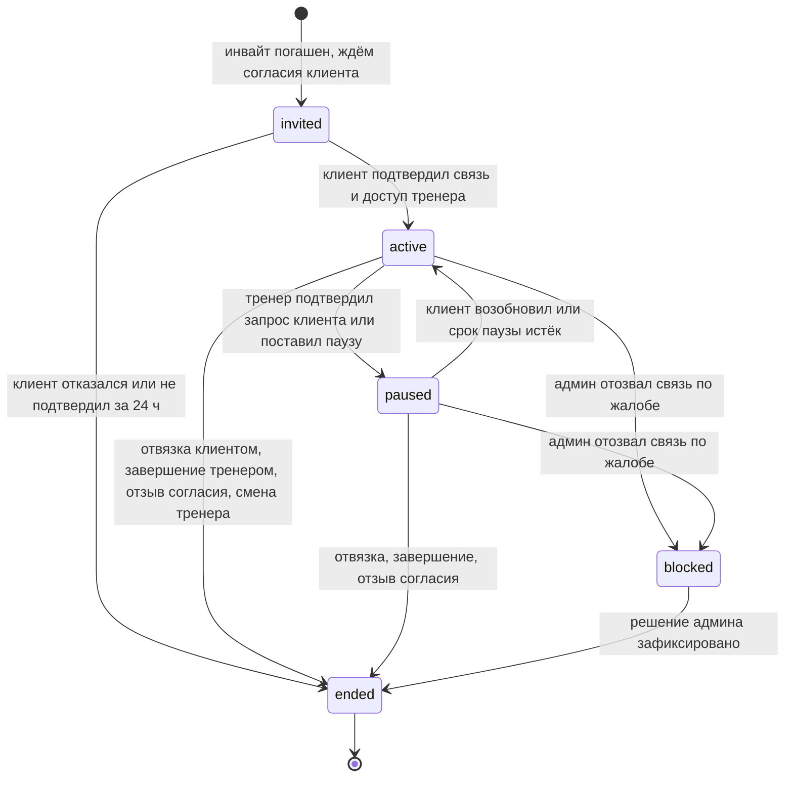

# 21. Customer journeys: сквозные сценарии

Дата: 2026-11-23. Статус: черновик v1 для ревью.
Основа: `00-validation.md` (решения O1–O8 приняты по рекомендациям оркестратора), `noexcuse/CLAUDE.md` (разделы 6, 8, 9), `План MVP v1.1` (разделы 2 и 5), исходное ТЗ (пользовательские пути 4.1–4.3, как исходный материал).

Соглашения:
- Экраны описаны словами, без пикселей. Тап = «нажать».
- Значения в скобках с пометкой «предл.» — предлагаемые константы конфигурации; их утверждает владелец продукта или специалист (для порога ккал — специалист).
- `[O#]` — зависимость от решения владельца; `K#` — дефект из 00-validation раздел 3, который сценарий требует исправить до его реализации.
- Инварианты, действующие во всех сценариях: см. раздел 2.4.

---

## 0. Как решения O1–O8 учтены в сценариях

| Решение | Рекомендация (принята) | Где в сценариях |
|---|---|---|
| O1 | Один аккаунт = одна роль; тренер, который тренируется сам, заводит второй аккаунт | JRN-01 шаг 1, JRN-14 шаг 5 |
| O2 | У клиента одна связь со статусом `invited/active/paused` | JRN-02 шаг 7, JRN-18 |
| O3 | Пауза не закрывает доступ тренера к данным; отключает напоминания и подсчёт пропусков; клиент запрашивает, тренер подтверждает (требует правки `link.ts`) | JRN-09 |
| O4 | Admin-lite до беты (отзыв связи, экспорт/удаление, аудит); полная веб-админка к запуску | JRN-16 |
| O5 | Must в бете: экран «Кому нужна реакция», напоминания клиенту, импорт CSV; комментарий к тренировке — Should | JRN-07 (экран), JRN-03 (импорт вне сценария, см. раздел 6 плана) |
| O6 | КБЖУ по плану тренера Must; дневник еды клиента — Should | JRN-08 |
| O7 | Страна и язык не выбраны: один язык, все строки в словаре | JRN-01 шаг 4, JRN-02 шаг 1 |
| O8 | Только онлайн-тренеры с 10+ клиентами: фильтр на входе в бету (вне приложения), в продукте не проверяется | JRN-01 (предусловие) |

Связанные решения из 00-validation: C5 (роль выбирается только «Я тренер» / «У меня есть код тренера»), C6 (пауза и отвязка Must у обеих сторон), C7 (обновление экрана ≤30 с, BR-SYNC-001), C3/C4 (северная метрика измеряется на 4-й неделе беты).

---

## 1. Карта ролей и точек входа

### 1.1. Точки входа

| Вход | Актор | Откуда начинает | Ведёт в |
|---|---|---|---|
| Установка из App Store / Google Play (TestFlight / Play internal в бете) | Тренер | Магазин приложений, без ссылки | JRN-01 |
| Установка из App Store / Google Play | Клиент с ссылкой | Ссылка из мессенджера → страница-посадка → магазин | JRN-02 |
| Открытие приложения по ссылке (universal link / app link, приложение установлено) | Клиент | Ссылка из мессенджера | JRN-02 (вариант А), JRN-15 |
| Установка без ссылки или код, полученный устно | Клиент | Магазин приложений | JRN-14 |
| Открытие приложения с уже активной связью | Клиент | Иконка приложения, push | JRN-04, JRN-06, JRN-08, JRN-09, JRN-11 |
| Открытие приложения тренером (телефон или планшет) | Тренер | Иконка приложения, push-дайджест | JRN-03, JRN-05, JRN-07, JRN-19, JRN-20 |
| Push о назначении или переносе | Клиент | Уведомление ОС | JRN-03 шаг 8, JRN-06 |
| Push-дайджест «Кому нужна реакция» | Тренер | Уведомление ОС (без имён на экране блокировки) | JRN-07 |
| Веб-страница-посадка (не требует установки) | Любой по ссылке | Ссылка из мессенджера | JRN-02 (вариант Б) |
| Веб-админка (Admin-lite) | Сотрудник поддержки | Браузер, вход через OIDC + MFA | JRN-16 |
| Фоновые задания (worker, pg-boss) | Система | Расписание по TZ пользователя | JRN-07 (оценка дня), JRN-09 (автовозобновление), JRN-12 (экспорт, удаление), JRN-17 (пересчёт напоминаний) |

### 1.2. Кто откуда начинает (кратко)

- Тренер всегда начинает с магазина и регистрации. Единственный путь к клиентам: свой инвайт.
- Клиент всегда начинает с ссылки или кода. Без связи с тренером клиентская часть приложения пуста (самостоятельных пользователей в MVP нет).
- Админ начинает с веб-входа и никогда с мобильного приложения.
- Система начинает сценарии по времени (конец дня в TZ клиента, DST, истечение сроков).

---

## 2. Сквозные правила

### 2.1. Константы и статусы

| Объект | Правило | Значение |
|---|---|---|
| Инвайт | Токен ≥128 бит, в БД хранится только хэш, одноразовый | Срок 7 дней (предл.) |
| Инвайт: лимит попыток погашения | Rate-limit на связку «устройство + IP» | 5 попыток / 10 мин (предл.) |
| Инвайт: лимит создания тренером | Защита от спама инвайтов | 20 инвайтов в сутки (предл.) |
| Короткий код для ручного ввода | Тот же токен, выводится группами; см. открытый вопрос в JRN-02 | Формат уточняется (UX-компромисс: 128 бит против длины ввода) |
| Статус связи (CoachClient) | `invited` (погашен, ждём согласия клиента) → `active` ⇄ `paused` → `ended`; админ → `blocked` → `ended` | См. раздел 4 (Mermaid) |
| Причины завершения связи | `client_unlink`, `coach_end`, `consent_revoked`, `coach_changed`, `account_deleted`, `admin_revoke`, `declined` | Фиксированный список, без свободного текста |
| Статус дня в календаре | `planned`, `in_progress`, `completed`, `partial`, `missed`, `moved`, `paused`, `hidden_by_plan` | `hidden_by_plan`: тренировку убрали из плана, факт сохранён |
| Статус подхода на клиенте | `draft` → `sending` → `saved` / `not_sent` | `saved` только после ответа сервера |
| Неактивность | Нет `WorkoutLog` N дней | N = 7 (предл.) |
| Оценка пропуска | Задание на локальное окно дня клиента | 00:30 локального времени следующего дня (предл.) |
| Незавершённая тренировка | Авто-закрытие после бездействия | 6 ч (предл.) → статус `partial` |
| Обновление экрана | Refetch при фокусе и pull-to-refresh | ≤30 с (BR-SYNC-001) |
| Таймаут запроса | Клиентский | 15 с |
| Срок ответа тренера на запрос паузы или переноса | Напоминание в дайджесте | 24 ч (предл.) |
| Ссылка на экспорт | Presigned URL | 7 дней |
| Отмена удаления аккаунта | Окно до окончательного удаления | 14 дней (предл.) |
| Порог ккал | Именованная константа `NUTRITION_KCAL_WARNING_MIN`, значение не задано | Утверждает специалист (00-validation раздел 4) |
| Окно переноса по правилам тренера | Настройка тренера | 7 дней вперёд, 2 переноса в неделю (предл. по умолчанию) |

### 2.2. Согласия (отдельные, версионированные, не предотмеченные)

| Код | Что | Обязательность | Связано с |
|---|---|---|---|
| `tos` | Условия использования | Обязательно | Аккаунт |
| `privacy` | Политика конфиденциальности | Обязательно | Аккаунт |
| `health` | Данные о здоровье, ст. 9 GDPR (тренировки, замеры, питание) | Обязательно для любой работы с данными | Аккаунт |
| `coach_access` | Доступ тренера к данным клиента | Обязательно для связи | Конкретная связь (K1) |
| `coach_nutrition` | Тренер видит питание | Опционально, по умолчанию выключено | Конкретная связь |
| `coach_measurements` | Тренер видит вес и замеры | Опционально, по умолчанию выключено | Конкретная связь |
| `marketing` | Маркетинг | Выключено по умолчанию, в MVP не используется | Аккаунт |

Каждая запись согласия хранит: тип, версию документа, время, источник (экран), `linkId` для связных типов. Отзыв — новая запись (append-only), а не удаление.

### 2.3. Ошибки и ответы API (для всех сценариев)

- Ошибки в формате RFC 9457 `{status, code, detail, requestId, errors[]}`. Клиент ветвится по `code`, не по тексту.
- Чужой ресурс и любое негативное состояние инвайта → 404 с одинаковым телом (без утечки существования).
- 401 → один refresh → при неудаче выход.
- Все мутации: клиентский UUID, `Idempotency-Key` (24 ч).
- Дата тренировки — `DATE` в TZ клиента; время в API — UTC ISO-8601.
- Офлайн-запись: явная ошибка «не сохранено», никогда «сохранено».

### 2.4. Инварианты (проверяются тестами во всех сценариях)

1. Доступ тренера к данным клиента проверяется на сервере при каждом запросе (`AccessPolicy`): активная связь + действующее согласие `coach_access` (+ его категории). Кэш доступа не используется как источник истины.
2. План ≠ факт: `WorkoutLog` хранит снимок упражнений и версию плана на момент старта. Правка плана, перенос или отвязка никогда не стирают факт.
3. Push, письма и экран блокировки не содержат имён упражнений, веса, питания, имён клиентов и причин.
4. Аналитика без PII и без данных здоровья: только внутренние псевдонимные UUID, коды событий, корзины (buckets) значений, версии.
5. Ни одно действие не показывает «сохранено» до ответа сервера.

---

## 3. Сценарии

### JRN-01. Тренер: от установки до первого приглашения

- **Цель:** тренер проходит регистрацию, MFA, профиль с TZ, видит пустой список и создаёт инвайт (код и ссылка), которым делится в мессенджер. Целевое время: первый клиент (приглашение отправлено) менее 5 минут.
- **Актор:** тренер (онлайн, 10+ клиентов, O8 — фильтр до бета-набора).
- **Предусловия:** установлено приложение (бета: TestFlight / Play internal); есть Apple ID, Google-аккаунт или email; сеть есть.
- **Основной поток:**

| № | Экран (словами) | Действие пользователя | Реакция системы | Данные / статусы | Альтернативы и ошибки |
|---|---|---|---|---|---|
| 1 | Приветствие: «Приложение для тренера и клиентов», две кнопки «Я тренер» и «У меня есть код тренера» | Нажимает «Я тренер» | Фиксирует выбор роли, переходит к входу | Роль `trainer` (O1: роль фиксируется один раз) | Нажал «У меня есть код» → JRN-14. Если аккаунт уже тренерский, а роль нужна клиентская → «Создайте отдельный аккаунт» (O1) |
| 2 | Вход: «Войти с Apple», «Войти с Google», «Почта» | Нажимает «Войти с Apple» | Системный OIDC-поток; сервер создаёт пользователя, связывает провайдера | `account.status = pending_profile`, MFA не настроен | Отмена в системном окне → экран входа без ошибки. Почта: ввод адреса → код → пароль у провайдера; 5 неверных кодов → пауза 10 мин. Провайдер недоступен → «Вход временно недоступен, повторите» |
| 3 | «Защитите аккаунт тренера»: вход в два шага (TOTP или passkey) | Нажимает «Настроить» | Регистрация фактора у провайдера; сервер ставит отметку | `mfa = enrolled` | Пропустить нельзя: клиентская часть закрыта до MFA. Провайдер недоступен → экран с «Повторить» |
| 4 | Профиль: имя (отображаемое), часовой пояс (предложен по устройству), язык (O7: по словарю) | Вводит имя, подтверждает TZ, отмечает «Условия» и «Конфиденциальность», нажимает «Продолжить» | Валидация той же zod-схемой, что на сервере; сохранение профиля; записи согласий `tos`, `privacy` | Профиль заполнен; TZ как IANA-идентификатор; `status = profile_complete` | Нет сети → «Не сохранено, нет связи с сервером», данные в форме сохраняются. Некорректный TZ → подсказка выбрать из списка |
| 5 | «Клиенты»: пустой список, текст «Пригласите первого клиента», кнопка «Пригласить» | Нажимает «Пригласить» | Открывает форму инвайта | Клиентов 0 | Состояние «нет клиентов» — штатное, не ошибка |
| 6 | «Новое приглашение»: поле «Заметка для себя» (необязательно, клиенту не показывается), срок (по умолчанию 7 дней), кнопка «Создать» | Нажимает «Создать» | Сервер генерирует токен, сохраняет хэш, возвращает ссылку и код; экран с «Код», «Ссылка», «Поделиться», «Копировать» | Инвайт `active`, срок 7 дн.; заметка не уходит в аналитику | Лимит 20 инвайтов/сутки → «Достигнут дневной лимит»; нет сети → «Приглашение не создано» (кода на экране нет) |
| 7 | Экран приглашения с кодом и ссылкой | Нажимает «Поделиться» | Открывается системное окно «Поделиться»; приложение не читает контакты и не отправляет сообщения само | Событие аналитики `invite_shared {channel: system_share}` | Пользователь закрыл шэр без отправки — инвайт остаётся `active`, в списке «Ожидает клиента» |
| 8 | «Клиенты» со строкой «Приглашение: ожидает клиента» | Возвращается на вкладку «Клиенты» | Список обновлён (фокус экрана, ≤30 с) | Клиентов 0, инвайтов 1 `active` | Тренер выходит из приложения на шаге 2 → при входе продолжает с шага, который не завершён (статус профиля) |

- **Альтернативы:** Apple отклонён → Google или почта. Почта уже занята другим способом входа → «Этот адрес уже используется. Войдите тем же способом, что и раньше». Сессия истекла на шаге 4 → вход снова, данные формы не теряются, если сеть есть.
- **Метрика успеха:** время от первого запуска до отправки инвайта (шаг 7): p50 ≤3 мин, p90 ≤5 мин (замер на бета-тренерах). Не менее 80% тренеров отправляют первый инвайт в первой сессии (предл.).
- **События аналитики (без PII):** `app_installed {store}`, `onboarding_role_chosen {role}`, `auth_method_selected {apple|google|email}`, `mfa_enrolled`, `profile_completed {tz_source: device|manual}`, `invite_created {ttl_days}`, `invite_shared {channel: system_share}`, `time_to_first_invite_ms`.

---

### JRN-02. Клиент: от ссылки до пустого «Сегодня»

- **Цель:** клиент по ссылке становится клиентом тренера, даёт согласия по отдельности, подтверждает связь и видит «Сегодня» с пустым состоянием.
- **Актор:** клиент, 18+.
- **Предусловия:** у клиента есть ссылка-инвайт (статус `active`); клиент не знает, установлено ли у него приложение.
- **Основной поток** (вариант Б: приложение не установлено; вариант А см. строку 1 альтернатив):

| № | Экран (словами) | Действие пользователя | Реакция системы | Данные / статусы | Альтернативы и ошибки |
|---|---|---|---|---|---|
| 1 | Страница-посадка: «Вас пригласили в NoExcuse», что будет дальше (связь с тренером, подтверждение после входа), кнопка «Установить» (App Store / Google Play) | Нажимает «Установить» | Переход в магазин. Страница не показывает имя тренера и не различает действительный и недействительный инвайт (нет оракула). Без сторонних трекеров | Никаких записей в БД | Вариант А (установлено): ссылка открывает приложение сразу на экран ввода кода (universal / app link). Открытый вопрос: отложенная ссылка (deferred link) в MVP не используется, чтобы не передавать код через магазин |
| 2 | Магазин → установка → первое открытие: «Я тренер» / «У меня есть код тренера» | Нажимает «У меня есть код» (или повторно нажимает ссылку из мессенджера после установки) | Открывается экран ввода с уже заполненным кодом (из ссылки) | Роль не назначена | Ссылка открыта без установки на другом устройстве → посадка повторяется |
| 3 | «Введите код тренера»: поле с кодом (заполнено), кнопка «Продолжить» | Нажимает «Продолжить» | Локальная проверка формата (без сервера). Токен кладётся в защищённое хранилище на время регистрации (до 24 ч) | Инвайт ещё не погашен | Неверный формат → «Проверьте код: он состоит из N символов». Ввод кода вручную: см. открытый вопрос (длина токена ≥128 бит, UX-компромисс) |
| 4 | Вход: Apple / Google / почта (как JRN-01 шаг 2) | Выбирает способ входа | Аккаунт создан с ролью `client` | `role = client`, `status = pending_age` | Отмена входа → возврат на шаг 3, код сохранён |
| 5 | «Вам есть 18 лет?» с «Да» и «Нет» | Нажимает «Да» | Записывает самодекларацию возраста (без даты рождения) | `age_gate = pass` | «Нет» → экран «NoExcuse только для 18+». Инвайт не погашается, дальнейшие данные не собираются, аккаунт не создаёт связи |
| 6 | Согласия: три отдельных переключателя «Условия» (обязательно), «Конфиденциальность» (обязательно), «Данные о здоровье» (обязательно для тренировок и замеров, с пояснением ст. 9); «Маркетинг» не показывается в MVP | Включает три обязательных переключателя и нажимает «Продолжить» | Записи согласий с версиями и временем; без `linkId` (связи ещё нет) | `tos`, `privacy`, `health` = granted | Отказ от `health` → «Без этого приложение не сможет вести тренировки. Выйти?» → выход без связи. Ничего не предотмечено |
| 7 | Экран «Тренер Анна хочет вести вас в NoExcuse»: список того, что тренер увидит (тренировки и факт — по умолчанию да; питание и замеры — переключатели, по умолчанию выкл.), чекбокс «Доступ тренера», кнопки «Подтвердить связь» и «Не сейчас» | Включает нужные переключатели, отмечает «Доступ тренера», нажимает «Подтвердить связь» | Сервер в одной транзакции: инвайт `consumed`, создаётся связь `invited`, записывается `coach_access` с `linkId`, затем связь переходит в `active` | Связь `active` (O2: одна связь); инвайт `consumed`; согласия `coach_access`, `coach_nutrition`, `coach_measurements` по выбору | Имя тренера показывается только здесь, после входа. «Не сейчас» → связь `ended(declined)`, инвайт остаётся погашенным (повторно не используется). Негативное состояние инвайта на redeem → JRN-15. У клиента уже есть связь с другим тренером → JRN-18 |
| 8 | «Сегодня»: «Тренер ещё не назначил тренировку», строка «Ваш тренер: Анна», блок «Цель по питанию» пуст с текстом «Появится после назначения». Pull-to-refresh работает | Нажимает «Понятно» (или ничего) | Предлагает включить напоминания мягко: «Напоминания о тренировках появятся после назначения. Разрешить сейчас?» с «Позже» | Назначенных тренировок 0 | Отказ от push — не блокирует работу; запрос повторяется после первого назначения (JRN-03 шаг 8) |

- **Альтернативы:** клиент закрыл приложение на шаге 5–7 → при повторном входе продолжает с того же шага (токен инвайта действует до 24 ч). Клиент повторно нажал ссылку после погашения → посадка «Код уже использован» не выводится; экран общий: «Код не подошёл, попросите новый у тренера» (JRN-15).
- **Метрика успеха:** от касания ссылки до «Сегодня» с назначенным тренером: p50 ≤2 мин при установленном приложении, ≤4 мин с установкой. Конверсия «открыл ссылку → подтвердил связь» ≥70% (предл.).
- **События аналитики (без PII):** `invite_landing_viewed {device_os}`, `store_redirect {store}`, `invite_entered {method: link|manual}`, `auth_method_selected`, `age_gate_result {pass|fail}`, `consent_decision {type, granted}`, `link_confirmed`, `link_declined`, `home_empty_shown`.

---

### JRN-03. Тренер: блок, тренировки, упражнения, назначение, питание, уведомление клиента

- **Цель:** тренер создаёт блок на 4 недели с тренировками и упражнениями, назначает на даты и ставит цель по питанию; клиент получает уведомление без данных в тексте. Целевое время (первый блок): ≤10 мин.
- **Актор:** тренер.
- **Предусловия:** активная связь с клиентом (JRN-02 пройден); тренер открыл карточку клиента.
- **Основной поток:**

| № | Экран (словами) | Действие пользователя | Реакция системы | Данные / статусы | Альтернативы и ошибки |
|---|---|---|---|---|---|
| 1 | Карточка клиента «Анна»: вкладки «Сегодня», «План», «Календарь», «Факт», «Питание», «Замеры». На «План» — пустой список блоков | Нажимает «План» → «Новый блок» | Открывается форма блока | Блоков 0 | Связь завершена или не существует → 404 → «Клиент недоступен» и возврат в список (без подробностей) |
| 2 | Форма блока: название, длительность (1–12 недель), цель (текст), «Сохранить» | Заполняет и нажимает «Сохранить» | Блок создан как черновик, версия 1 | Блок `draft` | Нет сети → «Не сохранено» |
| 3 | Блок: список тренировок (по умолчанию пусто), кнопка «Добавить тренировку» | Добавляет «День А — Ноги», порядок, сохраняет | Тренировка добавлена в черновик блока | Тренировка в черновике | Дубль названия — допустим (предупреждение) |
| 4 | Редактор тренировки: «Добавить упражнение» → выбор из каталога или ввод своего; на каждое — подходы: повторы (диапазон), вес (необязательно), отдых (сек., ≤600) | Выбирает «Приседания», задаёт 4 подхода по 8 повторов, отдых 90 сек., сохраняет | Валидация той же схемой, что на сервере; подходы сохраняются | Упражнение с `source = catalog|custom`; видео — Should, не обязательно | Некорректный диапазон → подсказка. Нет сети → «Изменения не сохранены» |
| 5 | Блок: кнопка «Опубликовать» | Нажимает «Опубликовать» → подтверждение «После публикации правки пойдут новой версией» → «Опубликовать» | Версия блока иммутабельна (снимок); черновик становится версией 1 | Блок `published`, версия 1 | Отмена — блок остаётся черновиком. Тренер удаляет тренировку до назначения — без подтверждения |
| 6 | «Назначить»: недельный календарь клиента, подпись «Даты в часовом поясе клиента: Europe/Berlin», выбор дат, стартовая дата | Отмечает понедельники и пятницы на 4 недели, нажимает «Назначить» | Создаются записи календаря с привязкой к версии плана клиента; ставится задание на уведомление | Записи `planned`; версия копии клиента зафиксирована | Конфликт с уже существующей тренировкой на дату → предупреждение «На этот день уже есть тренировка» (можно назначить рядом). Связь `ended` → «Недоступно» |
| 7 | Вкладка «Питание»: «Цель на день»: ккал, Б/Ж/У (г), текст рекомендаций; «Применить к датам» (диапазон) | Вводит 2100 ккал, Б 150, Ж 70, У 200, применяет на 4 недели, сохраняет | Проверка порога: ниже `NUTRITION_KCAL_WARNING_MIN` → требуется подтверждение | Цель сохранена; флаг `below_threshold` в аналитике без значения | Ниже порога → «Значение ниже порога. Подтвердите, что это назначено специалистом» + чекбокс → без подтверждения не сохраняется |
| 8 | Карточка клиента: «Назначено: 24 из 24 дат» и статус «Уведомление отправлено» | Ничего (контроль результата) | Событие `plan.assigned` в outbox → worker → push клиенту: «У вас новая тренировка» (без названия и упражнений). При открытии уведомления клиент попадает на «Сегодня» | Push `type = plan_assigned`, без PII | Push отключён у клиента → клиент увидит назначение при обновлении экрана (≤30 с). Тренер видит «Уведомление не доставлено» только при недействительном токене устройства, без подробностей |

- **Альтернативы:** тренер назначает во время паузы клиента → даты попадают в паузу и помечаются `paused` (JRN-09). Клиент отвязан до назначения → 404 на шаге 6 (JRN-10).
- **Метрика успеха:** время создания блока (4 тренировки) и назначения на 4 недели, p50 ≤10 мин на бета-тренерах. Не менее 60% тренеров назначают хотя бы один блок в первую неделю (предл.).
- **События аналитики (без PII):** `plan_block_created {weeks}`, `plan_published {version}`, `workout_added`, `exercise_added {source}`, `plan_assigned {dates_bucket}`, `nutrition_target_set {below_threshold: bool}`, `push_sent {type}`, `push_delivery {ok|failed}`. Без имён, весов и содержания рекомендаций.

---

### JRN-04. Клиент: «Сегодня» → тренировка → подходы → таймер → завершение → тренер видит факт

- **Цель:** клиент выполняет тренировку, каждый подход сохраняется после подтверждения сервера, тренер видит факт не позднее 30 с после обновления экрана.
- **Актор:** клиент.
- **Предусловия:** связь `active`; на сегодняшнюю дату (TZ клиента) назначена тренировка.
- **Основной поток:**

| № | Экран (словами) | Действие пользователя | Реакция системы | Данные / статусы | Альтернативы и ошибки |
|---|---|---|---|---|---|
| 1 | «Сегодня»: карточка «День А · Ноги · 5 упражнений · ~45 мин», цель КБЖУ, кнопка «Начать» | Нажимает «Начать» | Создаётся `WorkoutLog` со снимком плана и версией; `Idempotency-Key` | `WorkoutLog.status = in_progress`, `workout_date` (DATE в TZ клиента) | Тренировка уже начата на другом устройстве → открывается существующая, без дубля. Нет сети → «Не удалось начать, повторить» |
| 2 | Экран тренировки: список упражнений; у каждого: план (например, 10 × 60 кг, отдых 90 с), поля фактических повторов и веса (план — подсказка, не факт), кнопка «Отметить подход» | Вводит 8 повторов и 60 кг, нажимает «Отметить подход» | Подход отправляется; статус «Отправка…»; после ответа сервера «Сохранено» | Подход `sending → saved` | Нет сети → «Не отправлено», кнопка «Повторить»; очередь хранится на устройстве, зашифрованно. Значение вне диапазона (вес < 0, повторы > 200) → подсказка у поля |
| 3 | Таймер отдыха: обратный отсчёт 90 с, кнопка «Пропустить» | Ничего или «Пропустить» | Таймер локальный, сервера не касается; при сворачивании — локальное уведомление «Отдых закончился» без данных упражнения | Нет записи на сервере | Приложение убито — таймер не восстанавливается (допустимо) |
| 4 | Упражнение: подход с пометкой «Пропустить подход» | Нажимает «Пропустить подход», выбирает причину (необязательно: «Устал», «Нет снаряда», «Боль» — при «Боль» показывается совет остановиться и обратиться к врачу) | Подход `skipped`; факт сохраняется | `skipped` с кодом причины | При выборе «Боль» — текст о прекращении нагрузки и обращении к врачу, без диагноза |
| 5 | Кнопка «Завершить тренировку» | Нажимает «Завершить» | Если есть непройденные подходы — подтверждение «Осталось 3 подхода: завершить?»; после подтверждения статус `completed` или `partial` | `completed` (≥100% подходов выполнено) или `partial` | Нет сети → «Тренировка не завершена на сервере. Повторить»; состояние остаётся `in_progress` |
| 6 | Итог: «Выполнено 14 из 15 подходов», кнопка «Готово» | Нажимает «Готово» | Итог сохранён | `completed` или `partial` | Нет |
| 7 | «Сегодня»: «Тренировка выполнена», без повторного запуска | Ничего | Тренер получает факт при своём обновлении (≤30 с) | Календарь клиента `completed` | Тренер ещё не открывал приложение — факт ждёт; push тренеру только в дайджесте (JRN-07) |
| 8 | Тренер: карточка клиента «Факт»: строка «Сегодня, 14/15 подходов, partial» | Тренер открывает факт (контрольный шаг, без действий) | Факт виден; веса и повторы — по подходам, с датой и версией плана | Факт `partial`, версия `v3` | Клиентские данные видны только при активном `coach_access` и категории «Тренировки» (по умолчанию включена) |

- **Альтернативы:** приложение закрыто во время тренировки → при открытии экран «Незавершённая тренировка» с «Продолжить» и «Завершить». Неотправленные подходы уходят при восстановлении сети. Нет сети на весь сеанс → подходы «не отправлено», тренер ничего не видит, клиент не получает ложного «сохранено».
- **Метрика успеха:** 100% подходов с подтверждением сервера до показа «Сохранено» (тест); доля начатых тренировок, завершённых ≥80% (предл.); ошибок отправки подхода <0,5% сессий (предл.).
- **События аналитики (без PII и без значений):** `workout_started {plan_version}`, `set_logged {result: ok|retry}`, `rest_timer_used`, `set_skipped {reason_code}`, `workout_finished {status}`, `offline_queue_depth_bucket`. Веса, повторы, имена упражнений в аналитику не передаются.

---

### JRN-05. Тренер правит план после того, как клиент выполнил часть (план ≠ факт, версия, конфликт)

- **Цель:** тренер меняет тренировку, факт клиента не меняется, клиент видит правку при обновлении экрана, конфликтующие правки не теряются.
- **Актор:** тренер и клиент.
- **Предусловия:** клиент выполнил 2 из 4 тренировок недели; тренировка «День А» версии 3 опубликована и уже имеет факт; у клиента сегодня тренировка в статусе `in_progress` (вариант В ниже).
- **Основной поток:**

| № | Экран (словами) | Действие пользователя | Реакция системы | Данные / статусы | Альтернативы и ошибки |
|---|---|---|---|---|---|
| 1 | Карточка клиента → «План» → блок «Неделя 2» → «День А (версия 3)» с баннером «По этой тренировке есть факт: 2 выполнения. Правки не меняют факт» | Нажимает «Изменить» | Открывается редактор с текущей версией `v3` (передаётся в заголовке `If-Match`) | `v3` | Баннер появляется, если есть `WorkoutLog` по тренировке |
| 2 | Редактор: «Приседания 4 × 8» → «5 × 5»; «Разгибания» — удалить | Меняет подходы, удаляет упражнение, нажимает «Опубликовать» | Сервер проверяет `If-Match = v3`. Если версия уже `v4` (правка с другого устройства), ответ 409 `plan_version_conflict` | Новая версия `v4` или отказ | 409 → экран «План изменился на другом устройстве. Показать различия и применить свои правки?» с diff. Правки не теряются: черновик сохраняется локально до решения |
| 3 | Подтверждение: «Не начатые тренировки клиента получат версию 4. Прошедшие и начатые останутся на версии, по которой выполнены» | Нажимает «Опубликовать» | Транзакция: публикация `v4`; записи `planned` и дата ≥ сегодня ссылаются на текущую версию клиентской копии; записи с фактом и `in_progress` закреплены за своей версией. Событие `plan.changed` → дайджест клиенту, если изменение касается ближайших 7 дней | `v4`; `WorkoutLog` с `plan_version = v3` не меняется | Сеть пропала на сохранении → «Не опубликовано, версия прежняя», ничего не применено частично |
| 4 | Клиент, экран «Сегодня» (открыт во время правок) | Ничего (обновление при фокусе, ≤30 с) | Баннер: «План обновлён тренером: 5 × 5 вместо 4 × 8; «Разгибания» убраны» | Вариант А (не начата): «Начать по новому плану». Вариант В (`in_progress`): «Продолжить по версии 3», изменения не применяются к уже выполненным подходам | Нет сети → баннер не появится, но кнопка «Начать» использует версию с сервера при следующем запросе |
| 5 | Тренер: карточка «Факт», строка «Сегодня: 2 из 4 подходов по версии 3 (план обновлён после начала)»; удалённое упражнение «Разгибания» отмечено «Удалено из плана» | Просматривает факт | Факт не изменён, снимок упражнения сохранён в логе | Факт `v3`, статус `удалено из плана` для упражнения | Клиент отправил подход в момент удаления упражнения → подход принимается, название берётся из снимка, факт не теряется |
| 6 | Тренер: «История версий» блока (версия, время, кто, число изменённых записей; без значений нагрузки в журнале) | Открывает историю | Журнал версий, иммутабельный | Записи истории версий | Удаление прошедшей тренировки запрещено: доступна только «Скрыть из плана» (`hidden_by_plan`), факт сохраняется |

- **Альтернативы:** тренер правит на двух устройствах → 409 (шаг 2). Клиент отправляет подходы во время публикации → подходы сохраняются за версией `v3` (шаг 5). Клиент пытается перенести тренировку с фактом → JRN-06 отказывает.
- **Метрика успеха:** потерянных фактов после правок — 0 (тест: количество подходов до и после правки равно); 100% правок видны клиенту не позднее 30 с при фокусе; время правки тренера (минуты на правку до и во время беты, из плана раздел 1).
- **События аналитики (без PII):** `plan_version_published {version, changed_entries_bucket}`, `plan_conflict_409`, `plan_change_seen_by_client {accepted|kept_old}`, `fact_pinned_version_mismatch_count`. Содержимое правок не передаётся.

---

### JRN-06. Перенос тренировки (тренером и клиентом)

- **Цель:** тренировка переносится на другую дату без потери факта; у клиента и тренера одинаковый результат.
- **Актор:** тренер (А) и клиент (Б).
- **Предусловия:** тренировка в статусе `planned` (факта нет); связь `active` или `paused`.
- **Основной поток (А, тренер):**

| № | Экран (словами) | Действие пользователя | Реакция системы | Данные / статусы | Альтернативы и ошибки |
|---|---|---|---|---|---|
| 1 | Календарь клиента (неделя): тренировка на пятницу, меню «⋯» → «Перенести» | Нажимает «Перенести», выбирает понедельник в календаре | Экран подтверждения: «Перенести на пн 12.01? Напоминание сдвинется» | Новая дата ещё не сохранена | Есть факт → «Перенос недоступен: есть выполнение» (можно создать новую тренировку, см. JRN-05) |
| 2 | Подтверждение «Перенести» → на пн уже есть тренировка → «Поставить вторую или отменить?» | Нажимает «Поставить вторую» | Запись `moved` со ссылкой на новую дату; история переноса: от, до, кто, когда | `moved`, `actor = coach` | Нет сети → «Не перенесено». Клиент получает push «Тренировка перенесена на понедельник» без названия |

- **Основной поток (Б, клиент):**

| № | Экран (словами) | Действие пользователя | Реакция системы | Данные / статусы | Альтернативы и ошибки |
|---|---|---|---|---|---|
| 3 | «Сегодня» → кнопка «Перенести» → календарь с доступными датами (по правилам тренера: окно и лимит) | Выбирает доступную дату и нажимает «Перенести» | Если дата в правилах — перенос применяется сразу, статус `moved`; тренер видит это в календаре | `moved`, `actor = client`, `auto = true` | Дата вне правил → «Тренер согласует перенос»: создаётся запрос `move_requested` |
| 4 | Тренер: в календаре запрос на перенос («Анна просит перенести на вт 13.01») с «Разрешить» и «Отклонить» | Нажимает «Разрешить» или «Отклонить» и выбирает причину из списка («Занятость», «Не по плану», «Другое») | Решение сохраняется; клиент видит результат при обновлении экрана | `move_decided {decision, reason_code}` | Тренер не ответил за 24 ч → в дайджесте напоминание; запрос не применяется автоматически |
| 5 | Клиент: «Запрос отправлен тренеру. Ответ придёт в приложении» | Ничего | Ожидание без таймера-давления | `move_requested` | Тренер запретил перенос в правилах → кнопка называется «Запросить перенос» (всегда через запрос) |
| 6 | Клиент: прошлая дата или уже выполненная тренировка недоступны для выбора | Пытается выбрать | Недоступные даты серые, с подписью «Прошедшие даты недоступны» | Нет записи | Попытка через API → 422 с понятным кодом |
| 7 | Клиент: «Сегодня» показывает новую дату; нет сети на шаге 3 → «Нет сети — перенос не сохранён» | Повторяет при сети | Явная ошибка офлайн, без фиктивного успеха | Статус не меняется | Два переноса подряд в одну неделю сверх лимита → «Лимит переносов на неделю исчерпан. Запросите перенос тренеру» |

- **Метрика успеха:** 0 переносов тренировок с фактом (тест); доля запросов на перенос, решённых тренером за 24 ч, ≥90% (предл.); время от запроса до решения p50 ≤4 ч (предл.).
- **События аналитики (без PII):** `workout_moved {actor, auto, days_delta_bucket}`, `move_requested`, `move_decided {decision, reason_code}`.

---

### JRN-07. Пропуск: конец дня в TZ клиента → статус у тренера → реакция тренера

- **Цель:** пропуск фиксируется по локальному дню клиента; тренер видит, кому нужна реакция; клиент не получает давления или стыда.
- **Актор:** система (оценка), тренер (реакция), клиент (видит нейтральный текст).
- **Предусловия:** запланирована тренировка на дату D; нет факта; не перенесена; связь `active` (не `paused`).
- **Основной поток:**

| № | Экран (словами) | Действие пользователя | Реакция системы | Данные / статусы | Альтернативы и ошибки |
|---|---|---|---|---|---|
| 1 | Нет экрана: фоновое задание в 00:30 локального времени клиента (день D+1) | Ничего | Оценка дня D: сначала `in_progress` старше 6 ч → `partial`; затем без факта, без переноса и без паузы → `missed`. Задание идемпотентно | `CalendarEntry.status = missed` | Тренировка изменена по TZ в тот же день → оценка по TZ на момент окончания дня (JRN-17). Задание упало → повтор, алерт после 3 неудач |
| 2 | Тренер, список клиентов: строка «Анна: пропуск (1 день)» оранжевым | Открывает список «Клиенты» | Список показывает статусы: в плане, пропуск, нет активности, пауза | Статус клиента `missed` | Пауза → статус «Пауза», не «Пропуск» |
| 3 | Экран «Кому нужна реакция»: сортировка по пропускам, неактивности ≥N дней (красным), запросам на паузу и перенос | Открывает экран | Список клиентов, каждому — причина в одну строку | Признаки: `missed`, `inactive_7d`, `pause_requested`, `move_requested` | Пустой список → «Все клиенты в плане» |
| 4 | Push-дайджест в 09:00 (время тренера, предл.): «Есть клиенты, которым нужна реакция: 3» | Нажимает уведомление | Открывается экран «Кому нужна реакция» | Push без имён на экране блокировки | Уведомления выключены → экран доступен через вкладку |
| 5 | Карточка клиента → факт: пропущенный день подсвечен | Выбирает действие: «Перенести» (JRN-06 А), «Пауза» (JRN-09, инициатива тренера), «Отметить просмотренным» | Действие записывается; «Отметить просмотренным» не отправляет ничего клиенту | `reviewed_by_coach` | Вне приложения тренер может связаться с клиентом сам; чата в MVP нет |
| 6 | «Сегодня» клиента: нейтральный текст «Вчера тренировка не отмечена. Перенести на сегодня?» с «Перенести» и «Скрыть» | Нажимает «Скрыть» или «Перенести» | «Скрыть» убирает напоминание; «Перенести» — JRN-06 Б | Без записи о «провале» | Текст не содержит слов о нарушении; неактивность 7 дней → мягкое напоминание клиенту (настройка) |

- **Альтернативы:** клиент выполнил тренировку фактически, но не отметил → может отметить выполненной позже в течение 48 ч (статус `completed_late`, Should); после 48 ч факт не принимается, решение тренера через JRN-05.
- **Метрика успеха:** пропуск отмечен не позже 30 мин после окончания локального дня (p95); ошибочных пропусков (выполнено, но не отмечено) <2% по обращениям; тренер реагирует на «Кому нужна реакция» не позже 24 ч в ≥70% случаев (предл.).
- **События аналитики (без PII):** `entry_missed {days_bucket}`, `digest_sent {count_bucket}`, `coach_reaction {move|pause|reviewed}`, `inactive_threshold_reached {N}`. Имена клиентов и даты не передаются.

---

### JRN-08. Питание и вес/замеры клиента; предупреждение при ккал ниже порога

- **Цель:** клиент видит план питания, вносит вес и замеры, при итоге ниже порога получает спокойное предупреждение, тренер видит динамику только с согласием.
- **Актор:** клиент (основной), тренер (просмотр).
- **Предусловия:** связь `active`; согласие `health` и отдельные согласия `coach_nutrition` / `coach_measurements` (по выбору при JRN-02 шаг 7); тренер назначил цель на день.
- **Основной поток:**

| № | Экран (словами) | Действие пользователя | Реакция системы | Данные / статусы | Альтернативы и ошибки |
|---|---|---|---|---|---|
| 1 | «Сегодня»: блок «Цель по питанию»: 2100 ккал, Б 150, Ж 70, У 200, текст рекомендаций; кнопка «Подробнее» | Нажимает «Подробнее» | Открывается план на день: рацион-пример, текст, дисклеймер «Не медицинская рекомендация» | Цель назначена | Согласие на `coach_nutrition` не дано — блок виден клиенту (это его план), тренеру не виден |
| 2 | «Итог за день»: поля ккал, Б, Ж, У (все необязательные); кнопка «Сохранить» (Should по O6; просмотр плана — Must) | Вводит 1200 ккал, нажимает «Сохранить» | Проверка диапазона (0–10000 ккал). Если ниже `NUTRITION_KCAL_WARNING_MIN` — показывается предупреждение | `NutritionDayLog` на дату; флаг `below_threshold` | Предупреждение: «Итог ниже рекомендованного минимума. Это не медицинская рекомендация. Посоветуйтесь с тренером или врачом» с кнопками «Сохранить как есть» и «Изменить». Без давления и без слов о провале |
| 3 | «Вес и замеры»: поле веса, замеры (талия, бёдра, грудь) с датой, «Сохранить» | Вводит вес 78,4 и талию 84, нажимает «Сохранить» | Запись замера; повторный ввод за ту же дату заменяет значение с сохранением истории | `Measurement` на дату, `coach_measurements` учитывается | Нет сети → «Не сохранено», значение в форме остаётся |
| 4 | Тренер: карточка клиента → «Питание»: цель и итоги за неделю (если `coach_nutrition`); «Замеры»: таблица за 4 недели (если `coach_measurements`) | Открывает вкладки | Данные видны только с согласием; без графиков (графики — Later) | Доступ по `AccessPolicy` | Согласие отозвано → вкладка «Нет доступа к данным питания» (без подробностей) |
| 5 | Тренер, «Питание»: ввод цели ниже порога | Пытается сохранить цель ниже порога | Требуется подтверждение (JRN-03 шаг 7); клиент видит тот же дисклеймер | Флаг `below_threshold` | Без подтверждения не сохраняется |

- **Альтернативы:** клиент не вносит итоги — приложение ничего не напоминает о «пропусках питания» (нет стыдящих уведомлений). Итог ровно на пороге — предупреждения нет.
- **Метрика успеха:** ≥50% активных клиентов вносят вес не реже 2 раз в неделю (предл., бета); доля предупреждений, после которых клиент изменил итог, фиксируется (без попыток оптимизировать); жалоб на давление — 0.
- **События аналитики (без значений):** `nutrition_day_saved {has_macros}`, `below_threshold_warning_shown`, `warning_resolved {save|edit}`, `measurement_saved {type: weight|circ}`, `coach_nutrition_viewed`. Значения ккал, веса и замеров не передаются.

---

### JRN-09. Пауза (болезнь, отпуск)

- **Цель:** клиент и тренер согласованно ставят паузу; напоминания и пропуски не начисляются; доступ тренера к данным не меняется (O3).
- **Актор:** клиент (запрос), тренер (подтверждение или инициатива), система (возобновление).
- **Предусловия:** связь `active`.
- **Основной поток:**

| № | Экран (словами) | Действие пользователя | Реакция системы | Данные / статусы | Альтернативы и ошибки |
|---|---|---|---|---|---|
| 1 | «Профиль» → «Пауза»: выбор причины (болезнь, отпуск, другое), даты «с» и «по» (или без конца), текст «При боли остановитесь и обратитесь к врачу» | Выбирает «Болезнь», даты 3–10 декабря, нажимает «Запросить паузу» | Создаётся запрос; связь остаётся `active`; записи календаря не меняются | `PauseRequest {reason_code, from, to}`, `requested` | Нет сети → «Запрос не отправлен» |
| 2 | Тренер: «Кому нужна реакция» → «Запрос на паузу: Анна, 3–10 дек.» с «Подтвердить» и «Отклонить» | Нажимает «Подтвердить» | Связь переходит в `paused` на период; напоминания и подсчёт пропусков выключаются; записи периода → `paused`; доступ тренера к данным сохраняется | Связь `paused`; O3: `AccessPolicy` не меняется | Тренер «Отклонить» → клиент видит «Тренер не подтвердил паузу. Свяжитесь с ним вне приложения» |
| 3 | Клиент, «Сегодня»: «Пауза до 10 декабря. Напоминания выключены. Тренер сохраняет доступ к вашим данным, как и раньше» | Ничего | Пауза видна | `paused` | Клиент видит, что доступ тренера не меняется, и может отозвать согласие (JRN-11) |
| 4 | Тренер: попытка назначить тренировку на даты паузы | Назначает | Тренировки создаются, помечаются `paused`, напоминаний нет | Записи `paused` | Пауза не блокирует планирование, но не создаёт пропусков |
| 5 | Клиент: «Возобновить» (досрочно) или автоматически в 00:30 локального дня после конца паузы | Нажимает «Возобновить» или ничего не делает | Связь `active`; подсчёт пропусков и напоминания возобновляются; тренер получает уведомление «Анна вернулась к плану» | Связь `active` | Тренер ставит паузу сам (инициатива тренера) — без запроса клиента; клиент видит «Тренер поставил паузу» с причиной-категорией |

- **Альтернативы:** пауза дольше 60 дней → напоминание тренеру о пересмотре связи (предл.). Отвязка во время паузы → JRN-10. Отзыв согласия во время паузы → JRN-11.
- **Метрика успеха:** ответ тренера на запрос паузы ≤24 ч в ≥90% случаев (предл.); 0 пропусков, засчитанных внутри паузы (тест); доля связей, возобновлённых после паузы, ≥70% (предл.).
- **События аналитики (без PII):** `pause_requested {reason_code}`, `pause_decided {coach, approve|reject}`, `pause_started {initiator}`, `pause_resumed {by: client|auto}`.

---

### JRN-10. Отвязка: клиентом и тренером; повторный инвайт

- **Цель:** связь завершается сразу для доступа; будущие записи снимаются; история остаётся у клиента; повторная связь создаёт новую запись.
- **Актор:** клиент или тренер.
- **Предусловия:** связь `active` или `paused`.
- **Основной поток (клиент):**

| № | Экран (словами) | Действие пользователя | Реакция системы | Данные / статусы | Альтернативы и ошибки |
|---|---|---|---|---|---|
| 1 | «Профиль» → «Мой тренер: Анна» → «Отвязаться» → экран «Что произойдёт»: доступ тренера закроется сразу; будущие тренировки и напоминания от тренера снимутся; ваша история останется у вас; тренер её больше не увидит | Нажимает «Отвязаться» и подтверждает | Транзакция: связь `ended(client_unlink)`; `coach_access` и связанные категории отозваны; будущие записи `planned` и `paused` с датой ≥ сегодня удаляются (K8: обязательно к реализации); открытые запросы закрываются; тренер получает общее уведомление «Клиент завершил связь» без причины | `ended`; записи истории сохраняются | Нет сети → «Не выполнено, повторить»; доступ не закрывается частично |
| 2 | «Сегодня» → «Нет тренера. Введите код, чтобы связаться с новым тренером»; «История» доступна | Открывает «История» | Видна собственная история выполнения; записи плана тренера — только для чтения, с пометкой «Тренер: Анна (связь завершена)» | Факт клиента сохранён | Попытка открыть данные тренера через старую ссылку → 404 |

- **Основной поток (тренер):**

| № | Экран (словами) | Действие пользователя | Реакция системы | Данные / статусы | Альтернативы и ошибки |
|---|---|---|---|---|---|
| 3 | Карточка клиента → «⋯» → «Завершить связь»: «Клиент потеряет доступ к назначенным тренировкам. Факт клиента перестанет быть видимым вам. Клиент получит уведомление. Ваши заметки о клиенте будут удалены» | Выбирает причину из списка («Цель достигнута», «Не сошлись», «Другое»), нажимает «Завершить» | Транзакция как в шаге 1, причина `coach_end`; заметки тренера о клиенте удаляются (минимизация данных) | `ended(coach_end)` | Клиент получает push без причины. Тренер больше не видит карточку (404) |
| 4 | Тренер: список клиентов без Анны (связи завершённые — отдельно за 30 дней, предл.) | Ничего | Доступ закрыт | — | Попытка назначить после завершения → 404 «Клиент недоступен» |

- **Повторный инвайт (тренер и клиент):**

| № | Экран (словами) | Действие пользователя | Реакция системы | Данные / статусы | Альтернативы и ошибки |
|---|---|---|---|---|---|
| 5 | Тренер: «Пригласить клиента» → «Новый код» (JRN-01 шаг 6) | Создаёт инвайт | Новый инвайт; старые согласия не переносятся (K1) | Инвайт `active` | Клиент погашает → новая запись связи; старые планы-копии остаются в завершённой истории |
| 6 | Клиент: экран подтверждения связи (JRN-02 шаг 7) | Подтверждает | Новая связь `active`, новые согласия | Связь `active` (новая запись) | «Не сейчас» → отказ, связь `ended(declined)` |

- **Альтернативы:** назначение тренером и отвязка клиентом одновременно → последняя транзакция побеждает, назначение получает 404. Нет сети → «Отвязка не выполнена» (фиктивного успеха нет).
- **Метрика успеха:** доступ закрыт в ≤1 с после подтверждения (тест IDOR); 0 будущих записей после отвязки (тест); отвязка проходит ≤1 мин от нажатия до подтверждения.
- **События аналитики (без PII):** `link_ended {reason_code, initiator: client|coach|admin|consent|account}`, `future_entries_removed {count_bucket}`, `invite_recreated_after_end`.

---

### JRN-11. Отзыв согласия на доступ тренера

- **Цель:** клиент отзывает доступ тренера или отдельную категорию данных; отзыв действует сразу и каскадно; никакого молчаливого продления доступа (K5).
- **Актор:** клиент.
- **Предусловия:** связь `active`; согласия выданы.
- **Основной поток:**

| № | Экран (словами) | Действие пользователя | Реакция системы | Данные / статусы | Альтернативы и ошибки |
|---|---|---|---|---|---|
| 1 | «Профиль» → «Согласия»: список «Условия» (версия, дата), «Конфиденциальность», «Данные о здоровье», «Доступ тренера Анны», «Питание для тренера», «Замеры для тренера», «Маркетинг» (выкл.) | Выключает переключатель «Доступ тренера Анны» | Экран: «Тренер потеряет доступ, связь завершится. Вы сможете связаться с новым тренером по коду» с «Отозвать» и «Отмена» | — | Нет сети → «Не сохранено» |
| 2 | Подтверждение «Отозвать» | Нажимает «Отозвать» | Запись отзыва `coach_access` с `linkId` (append-only, K1); связь `ended(consent_revoked)`; каскад как JRN-10 шаг 1; тренер получает общее уведомление «Клиент отозвал доступ» | `ended(consent_revoked)` | Отзыв применяется на сервере в той же транзакции; доступ не живёт в кэше |
| 3 | «Питание для тренера»: выключить (связь остаётся) | Выключает переключатель | Тренер теряет доступ к питанию и итогам за дни после отзыва; тренировки и связь не меняются | `coach_nutrition` отозвано | Тренер открывает вкладку → «Нет доступа к данным питания» |
| 4 | «Данные о здоровье»: предупреждение «Без этого согласия приложение не ведёт тренировки и замеры. Связь с тренером завершится, сбор остановится. Данные будут удалены в течение 30 дней (предл.), бэкапы — по сроку ротации» | Выключает и подтверждает | Связь завершается (`consent_revoked`); сбор данных останавливается; запускается удаление данных здоровья в срок (JRN-12) | `health` отозвано | Клиент может сначала экспортировать данные (JRN-12) |
| 5 | Клиент: уведомление о новой версии условий (блокирующий экран «Обновлённые условия», «Принять» и «Выйти») | Принимает или выходит | Принятие — новая запись версии. Отказ от `health`/`tos` → выход и путь удаления (JRN-12). Отказ от `coach_access` при обновлении → связь завершается | Версия согласия; до принятия данные тренеру не показываются (K5: не «молча») | Нет сети → экран остаётся, доступ тренера приостановлен |

- **Альтернативы:** повторное включение согласия не восстанавливает связь: нужен новый инвайт (K1). Отзыв во время паузы → JRN-10 с причиной `consent_revoked`.
- **Метрика успеха:** отзыв действует на сервере не позже 1 с (тест); 0 запросов тренера с доступом после отзыва (тест IDOR); 100% отзывов фиксируются записью согласия.
- **События аналитики (без PII):** `consent_withdrawn {type, link_scope: yes|no}`, `consent_renewed {type, version}`, `consent_version_prompt {shown|accepted|declined}`.

---

### JRN-12. Экспорт данных и удаление аккаунта (клиент, тренер)

- **Цель:** пользователь получает свои данные в машиночитаемом виде и удаляет аккаунт с каскадом; срок по GDPR — до 1 месяца, целевой ≤24 ч для экспорта.
- **Актор:** клиент, тренер.
- **Предусловия:** аккаунт активен; вход выполнен; для удаления — повторная аутентификация (step-up).
- **Основной поток (клиент, экспорт):**

| № | Экран (словами) | Действие пользователя | Реакция системы | Данные / статусы | Альтернативы и ошибки |
|---|---|---|---|---|---|
| 1 | «Профиль» → «Мои данные» → «Запросить экспорт»: «Файл будет готов в течение 24 ч; ссылка действует 7 дней» | Нажимает «Запросить экспорт» | Запрос в очереди; worker собирает архив: профиль, согласия, тренировки, питание, замеры, история связей (без внутренних заметок тренера); файлы в S3 с presigned URL; push «Экспорт готов» без содержимого | `export_request {status: queued → ready}` | Ошибка сборки → 3 повтора, затем очередь админа (JRN-16). Нет сети → «Не отправлено» |
| 2 | «Мои данные»: «Скачать (до 7 дней)» | Нажимает «Скачать» | Скачивание по presigned URL; истёкшая ссылка → «Срок ссылки истёк. Запросите экспорт заново» | Срок 7 дн. | Повторный запрос раз в 24 ч (предл.) |

- **Основной поток (клиент, удаление):**

| № | Экран (словами) | Действие пользователя | Реакция системы | Данные / статусы | Альтернативы и ошибки |
|---|---|---|---|---|---|
| 3 | «Профиль» → «Удалить аккаунт»: что удалится, «Сначала экспорт», «Удалить аккаунт» | Нажимает «Удалить аккаунт», проходит повторную аутентификацию | Запрос на удаление; связи завершаются (`account_deleted`); тренер получает общее уведомление; доступ тренера закрывается сразу; сессии и push-токены отзываются; вход отключён | `deletion_requested`, дата окончательного удаления = +14 дн. (предл.) | Повторная аутентификация не прошла → удаление не начато |
| 4 | Экран «Аккаунт будет удалён {дата}. Отменить» | Ничего или «Отменить» | До окончательного удаления можно отменить: аккаунт восстанавливается, связь не возвращается автоматически (нужен инвайт) | `deletion_pending` | Окно истекло → экран входа: «Аккаунт удалён» |
| 5 | Окончательное удаление (фоновое задание) | Нет | Удаление строк БД, объектов S3, данных Sentry (идентификатор заменяется); бэкапы истекают по ротации; аудит-запись без PII | `deleted` | Сбой задания → повтор, алерт; очередь админа |

- **Основной поток (тренер, удаление):**

| № | Экран (словами) | Действие пользователя | Реакция системы | Данные / статусы | Альтернативы и ошибки |
|---|---|---|---|---|---|
| 6 | «Профиль» → «Удалить аккаунт тренера»: «Активных клиентов: 3. Их связи будут завершены с уведомлением. Записи назначенных клиентам тренировок останутся в истории клиентов с пометкой «Тренер удалён». Экспорт ваших данных (профиль, шаблоны, список клиентов)» | Экспортирует, подтверждает и проходит повторную аутентификацию | Все связи → `ended(account_deleted)`; шаблоны тренера удаляются; копии у клиентов сохраняются как история клиента с анонимизированным автором; дальше — как шаг 3–5 | `deleted` после 14 дн. | Тренер не экспортировал → подтверждение «Удалить без экспорта?» |

- **Альтернативы:** экспорт упал на 3 повторе → JRN-16. Клиент удаляет аккаунт во время тренировки → `in_progress` закрывается как `partial`, неотправленные подходы не принимаются и показываются как «не отправлено» до удаления.
- **Метрика успеха:** экспорт готов ≤24 ч (p90); 100% удалений проходят каскад (тест); 0 данных здоровья в логах и текстах push (проверка).
- **События аналитики (без PII):** `export_requested {role}`, `export_ready`, `deletion_requested {role}`, `deletion_cancelled`, `deletion_completed`. Причины удаления — не собираются.

---

### JRN-13. Плохая сеть, офлайн, истёкшая сессия

> **Внимание (OF-1, OF-2 из `32-q2-offline-local-db.md`):** шаги с очередью подходов, переживающей перезапуск, и кэшем «любых данных» противоречат `CLAUDE.md` §6 и действуют только как уровни T1/T2 после ADR и одобрения владельца. В MVP (T0) офлайн = явная ошибка, подход «Не отправлено» живёт только в памяти экрана.

- **Цель:** пользователь всегда понимает, что сохранено, а что нет; ни один запрос не выдаёт фиктивный успех; данные другого пользователя не остаются на устройстве.
- **Актор:** клиент или тренер.
- **Предусловия:** любое состояние, где есть ограниченная сеть или истёкший токен.
- **Основной поток:**

| № | Экран (словами) | Действие пользователя | Реакция системы | Данные / статусы | Альтернативы и ошибки |
|---|---|---|---|---|---|
| 1 | Любой экран без сети: баннер «Нет сети. Показаны данные на {время}» и кэш последней загрузки | Открывает приложение офлайн | Чтение из кэша (только то, что было загружено этим пользователем); без подстановки демо-данных | Кэш помечен временем | Нет кэша → экран «Нет сети. Повторить» |
| 2 | Тренировка, отметка подхода без сети | Нажимает «Отметить подход» | Подход «Не отправлено», кнопка «Повторить»; очередь на устройстве (в зашифрованном хранилище), переживает перезапуск | `not_sent` | Успех показывается только после ответа сервера (инвариант 5) |
| 3 | Медленная сеть: спиннер; через 15 с — «Сервер не отвечает. Повторить» | Ждёт или нажимает «Повторить» | Повтор с тем же `Idempotency-Key` безопасен | Запрос повторён | Двойная отправка подхода не создаёт дубль |
| 4 | Истёкшая сессия: любой запрос | Ничего | Один refresh; при неудаче — выход: «Войдите снова. Несохранённые подходы сохранены на устройстве» | Сессия закрыта, очередь сохранена для этого аккаунта | Есть очередь и пользователь выходит сам → «Есть N неотправленных подходов. Выйти всё равно?» |
| 5 | Вход после истечения сессии | Входит тем же аккаунтом | Очередь отправляется; при расхождении аккаунта очередь удаляется с предупреждением до входа | Очередь пуста | Другой аккаунт на устройстве → сначала предупреждение о стирании очереди |
| 6 | Ошибки сервера: экран с локализованным текстом по `code`; мелким шрифтом requestId для поддержки | Нажимает «Повторить» | 5xx: повтор по политике; 429: «Слишком много попыток. Подождите N с» | Код ошибки | Неизвестный `code` → общий текст, без фиктивного успеха |

- **Альтернативы:** нет сети при завершении тренировки → «Тренировка не завершена на сервере», статус `in_progress`. Нет сети при отвязке, отзыве согласия, переносе → явная ошибка (JRN-10, JRN-11, JRN-06).
- **Метрика успеха:** 0 случаев «сохранено» без ответа сервера (тест); ≥99% неотправленных подходов уходят в течение 1 мин после восстановления сети (предл.); сбоев из-за очереди — 0 (тест перезапуска).
- **События аналитики (без PII и без тела запроса):** `offline_detected`, `request_failed {code, status_class}`, `queue_flushed {count_bucket}`, `session_expired`, `relogin_success`.

---

### JRN-14. Клиент установил приложение без инвайта

- **Цель:** человек, установивший приложение без ссылки, понимает, что делать; аккаунт не собирает данных о здоровье без связи с тренером.
- **Актор:** клиент без инвайта.
- **Предусловия:** приложение установлено; ссылки нет.
- **Основной поток:**

| № | Экран (словами) | Действие пользователя | Реакция системы | Данные / статусы | Альтернативы и ошибки |
|---|---|---|---|---|---|
| 1 | Приветствие: «Я тренер» / «У меня есть код тренера» | Нажимает «У меня есть код тренера», затем проходит вход | Роль `client`, статус `waiting_for_invite` | Роль зафиксирована | Нажал «Я тренер» по ошибке → JRN-01; смена роли допустима до первого инвайта или первого сохранённого профиля тренера (O1), иначе → «Создайте отдельный аккаунт» |
| 2 | «Ждём связь с тренером»: «Введите код, который дал тренер. Ссылка из мессенджера тоже подойдёт»; кнопки «Ввести код», «Как получить код» (статичная справка) | Нажимает «Ввести код» | Переход к JRN-02 шаг 3 | Без отправки кода в сеть до ввода | «Как получить код» — текст без кнопки отправки и без адресов тренеров |
| 3 | «Вы пока не с тренером» на «Сегодня»; вкладки «Профиль» и «Помощь» доступны | Ничего | Пустое состояние; замеры, питание и тренировки не доступны (нет связи — нет данных здоровья) | `waiting_for_invite` | Попытка открыть разделы по ссылке → 404 |
| 4 | Push-запрос не показывается до первой связи | Нет | Разрешение запрашивается на шаге JRN-02 шаг 8 | — | — |
| 5 | Экран «Ждём связь» спустя 90 дней без активности (предл.) | Ничего | Напоминание, затем предложение удалить аккаунт (JRN-12) | — | Удаление по запросу в любой момент |

- **Метрика успеха:** доля пользователей «ждём связь», которые вводят код в течение 7 дней, ≥40% (предл.); 0 данных здоровья без связи (тест).
- **События аналитики (без PII):** `role_chosen {client_no_code}`, `waiting_for_invite_shown`, `invite_entered_late`, `role_switch_blocked`.

---

### JRN-15. Истёкший, использованный или отозванный инвайт

- **Цель:** на любой негативный сценарий инвайта клиент получает одинаковый ответ; тренер видит статусы своих приглашений и может отозвать или перевыпустить.
- **Актор:** клиент (погашение), тренер (управление).
- **Предусловия:** ссылка или код, полученные клиентом.
- **Основной поток:**

| № | Экран (словами) | Действие пользователя | Реакция системы | Данные / статусы | Альтернативы и ошибки |
|---|---|---|---|---|---|
| 1 | Клиент: после входа экран «Код не подошёл. Проверьте ссылку или попросите тренера отправить новую» с «Ввести другой код» и «Назад» | Нажимает «Ввести другой код» | Сервер на redeem возвращает 404 с одинаковым телом для: неизвестного, истёкшего, использованного, отозванного кода | Инвайт не меняется | Одинаковый ответ — инвариант (тест на равенство тела и времени ответа) |
| 2 | Клиент: при превышении лимита попыток → «Слишком много попыток. Попробуйте через 10 минут» | Ждёт | Rate-limit 429 (лимит по устройству и IP) | Блокировка на 10 мин | Ответ не раскрывает валидность кода |
| 3 | Клиент: та же пара «тренер + клиент» уже в статусе `active`, код валиден | Погашает ссылку | Ответ 404 (как шаг 1), связь не дублируется. Открытый вопрос безопасности: для точного сообщения «у вас уже есть связь с этим тренером» потребуется отдельный ответ, он раскрывает валидность кода, поэтому в MVP не вводится | Связь не дублируется | См. открытые вопросы раздела 5 |
| 4 | Тренер: «Приглашения», строки со статусами: «Активно», «Использовано (клиент, дата)», «Истекло», «Отозвано» | Открывает строку «Активно» → «Отозвать» → подтверждение | Инвайт `revoked`; ссылка перестаёт работать; статус виден тренеру | `revoked` | Нет сети → «Не отозвано», ссылка может ещё работать — тренер видит это в тексте ошибки |
| 5 | Тренер: строка «Истекло» → «Новый код» | Нажимает «Новый код» | Создаётся новый токен; старый не работает | Инвайт `active`, новый срок | Лимит 20 в сутки (JRN-01) |

- **Альтернативы:** два клиента одновременно погашают один код → атомарная транзакция: первый получает связь, второй — 404. Опечатка при ручном вводе → 404 (то же сообщение).
- **Метрика успеха:** 0 различий в ответах для негативных состояний (тест на тело и код); тренер перевыпускает код не более чем за 30 с; доля ошибок ввода кода в первой сессии ≤10% (предл.).
- **События аналитики (без PII):** `invite_redeem_result {ok|negative|rate_limited}` (внутренняя причина негативного состояния пишется только в серверный лог без PII), `invite_revoked {by: coach}`, `invite_regenerated`.

---

### JRN-16. Администратор: отзыв связи по жалобе, аудит, обработка запросов на удаление (Admin-lite, O4)

- **Цель:** поддержка реагирует на жалобу, отзывает связь с причиной, всё действие попадает в append-only аудит; запросы на удаление и экспорт не теряются.
- **Актор:** сотрудник поддержки (роль `support` или `moderator`), `super_admin` для временного доступа к здоровью.
- **Предусловия:** сотрудник заведён в RBAC; вход через OIDC с MFA; жалоба зарегистрирована тикетом.
- **Основной поток:**

| № | Экран (словами) | Действие пользователя | Реакция системы | Данные / статусы | Альтернативы и ошибки |
|---|---|---|---|---|---|
| 1 | Веб-админка (Admin-lite): вход, MFA, экран «Очередь» | Входит | Сессия 30 мин без активности; каждое действие фиксируется | Аудит: вход | Без MFA — доступа нет |
| 2 | «Тикет»: данные связи (id, статус, даты, роли, число клиентов). Строка «Данные здоровья: скрыты, нужен грант по тикету» | Открывает тикет и связь | Видны только метаданные пользователей и связи | Просмотр метаданных — аудит | Попытка открыть тренировки или замеры без гранта → отказ и запись в аудит |
| 3 | «Отозвать связь»: причина из списка (жалоба на тренера, нарушение условий, по запросу пользователя, ошибка связи), внутренний комментарий (без данных здоровья), номер тикета | Выбирает причину, вводит тикет, подтверждает двумя нажатиями | Связь → `blocked` (или `ended(admin_revoke)`); каскад как JRN-10; запись в аудит: кто, что, когда, причина, тикет | `blocked` → `ended(admin_revoke)` | Ошибочный отзыв: восстановления связи нет, нужен новый инвайт |
| 4 | Уведомления: клиенту «Связь с тренером завершена службой поддержки. Подробности — в письме»; тренеру «Связь с клиентом завершена администрацией» | Нет | Тексты без причины и данных | Push без PII | Если письмо не отправлено → очередь поддержки |
| 5 | «Запросы»: очередь удаления и экспорта (срок ≤1 мес, целевой ≤14 дн.), статус «Ожидает», «Ошибка», «Готово» | Нажимает «Повторить» у ошибочной задачи | Повтор задания; экспорт чужих данных админу не доступен | Статус задачи | Задача не выполнена за 3 повтора → алерт дежурному |
| 6 | Расследование с доступом к здоровью: «Запросить грант» (тикет, срок 1 ч) → одобрение второго `super_admin` → просмотр с записью аудита на каждое открытие | Запрашивает и одобряет | Временный грант; истечение автоматическое | Аудит: грант, каждый просмотр | Без второго одобрения грант не выдаётся |

- **Альтернативы:** жалоба на тренера во время беты → решение и уведомление в течение рабочего дня. Жалоба без тикета не принимается в работу (тикет обязателен).
- **Метрика успеха:** реакция на жалобу ≤24 ч в рабочее время (предл.); 100% действий в аудите (тест); просмотров здоровья без гранта — 0; запросы на удаление выполняются ≤14 дн. (целевой срок), ≤1 мес. (законный предел).
- **События аналитики (внутренние, без PII):** `admin_action {type, reason_code}`, `grant_requested`, `grant_issued {ticket_ref}`, `export_job_failed {count}`.

---

### JRN-17. Смена часового пояса и переход на летнее время (DST)

- **Цель:** напоминания срабатывают в правильный локальный час, даты тренировок не сдвигаются, пропуски считаются по дню клиента.
- **Актор:** клиент (смена TZ), система (пересчёт), тренер (видит TZ клиента).
- **Предусловия:** у клиента сохранён IANA-часовой пояс; назначены тренировки.
- **Основной поток:**

| № | Экран (словами) | Действие пользователя | Реакция системы | Данные / статусы | Альтернативы и ошибки |
|---|---|---|---|---|---|
| 1 | Баннер: «Вы сейчас в поясе Europe/Lisbon. Сменить на него?» с «Сменить» и «Оставить» | Нажимает «Сменить» | Пояс сохраняется; напоминания на 14 дней пересчитываются (задание); даты тренировок (DATE) не меняются | `user.tz` обновлён; `reminders_rescheduled` | Пояс не из списка IANA → «Выберите пояс из списка» |
| 2 | Экран «Сегодня» после смены | Обновляет экран | «Сегодня» — по новому локальному дню; тренировка на сегодня (по дате) остаётся на той же календарной дате | — | Смена TZ в середине дня не переносит тренировку |
| 3 | DST (весна, 02:00 → 03:00): напоминание, назначенное на 02:30, срабатывает в 03:00 | Нет | Правило: несуществующее локальное время → ближайшее допустимое | Напоминание | Осенний переход (02:30 дважды): срабатывает один раз, первое вхождение |
| 4 | Тренер: карточка клиента, строка «Часовой пояс клиента: UTC+1» и подпись «Даты назначения — по часовому поясу клиента» | Просматривает | TZ тренера отдельно в его профиле | Клиент: `tz` | Тренер назначает во время перехода — даты DATE, сдвига нет |
| 5 | Оценка пропусков: день, уже оценённый как `missed`, не пересматривается при смене TZ | Нет | Оценка необратима (инвариант факта) | `missed` сохранён | Если TZ сменена до окончания дня — оценка по новому поясу на момент оценки |

- **Альтернативы:** автоматическая смена TZ без подтверждения запрещена (поездка не должна молча менять план). Экран «Сегодня» в день смены показывает одну тренировку, без дубля.
- **Метрика успеха:** 0 напоминаний со сдвигом ≥1 ч на двух DST-переходах (тест на эмуляторах с разными зонами); пересчёт напоминаний ≤1 мин после смены; смена TZ только после подтверждения (100%).
- **События аналитики (без PII):** `tz_change_suggested {accepted|rejected}`, `tz_changed {offset_delta_bucket}`, `reminders_rescheduled {count_bucket}`. Название зоны (город) не передаётся, только разница смещения.

---

### JRN-18. Смена тренера у клиента

- **Цель:** клиент переходит к новому тренеру без периода без тренера и без утечки данных старому.
- **Актор:** клиент; старый и новый тренер — получатели уведомлений.
- **Предусловия:** у клиента связь `active` с тренером A; есть инвайт от тренера B (O2: одна связь).
- **Основной поток:**

| № | Экран (словами) | Действие пользователя | Реакция системы | Данные / статусы | Альтернативы и ошибки |
|---|---|---|---|---|---|
| 1 | Клиент: погашение кода тренера B (JRN-02 шаг 3–6), затем экран «У вас уже есть тренер — Анна. Перейти к Борису? Связь с Анной завершится после подтверждения» с «Перейти к Борису» и «Оставить Анну» | Нажимает «Перейти к Борису» и отмечает согласие доступа к Борису | Связь B создаётся как `invited`; связь A пока `active`; согласия для B отдельные | Связь B `invited`; A `active` | «Оставить Анну» → связь B `ended(declined)`, A без изменений |
| 2 | Клиент: подтверждение → экран «Вы перешли к Борису» | Нажимает «Готово» | Одна транзакция (O2): связь A → `ended(coach_changed)` с отзывом `coach_access` для A; связь B → `active`. Будущие записи A удаляются (K8) | A `ended`, B `active` | Сбой транзакции → ничего не меняется, A остаётся активной (нет периода без тренера) |
| 3 | Тренер A: уведомление «Клиент перешёл к другому тренеру» | Ничего | Доступ A к данным закрыт в той же транзакции | — | Тренер A видит карточку клиента как завершённую (404) |
| 4 | Клиент: «Сегодня» показывает тренера Бориса; записи от Анны не видны; история выполненного остаётся клиенту | Ничего | Новые назначения приходят от Бориса | История клиента: факт с пометкой «Тренер: Анна (связь завершена)» | Тренер Борис не видит историю Анны (нет доступа, нет передачи) |

- **Альтернативы:** клиент сначала отвязывается от A (JRN-10), затем погашает код B — допустимо, но период без тренера возможен. Инвайт B недействителен → 404 (JRN-15), связь A не меняется.
- **Метрика успеха:** 0 случаев «связь с тренером отсутствует», если клиент подтвердил B (тест); доступ A закрыт в той же транзакции (тест); время перехода ≤2 мин.
- **События аналитики (без PII):** `coach_change_started`, `coach_change_confirmed`, `coach_change_declined`.

---

### JRN-19. Тренер на планшете: массовое копирование недели

- **Цель:** тренер копирует неделю плана на несколько клиентов или на несколько недель за одну операцию с предпросмотром конфликтов; либо отменяет операцию.
- **Актор:** тренер (планшет ≥768 dp по ширине; телефон — упрощённый вариант на одного клиента).
- **Предусловия:** у тренера ≥2 активных клиентов; есть блок с неделей-источником.
- **Основной поток:**

| № | Экран (словами) | Действие пользователя | Реакция системы | Данные / статусы | Альтернативы и ошибки |
|---|---|---|---|---|---|
| 1 | Планшет: слева список клиентов, справа календарь недели выбранного клиента; кнопка «Копировать неделю» | Нажимает «Копировать неделю» | Режим копирования открыт | — | На телефоне — кнопка есть, но только для одного клиента |
| 2 | «Источник и цель»: выбор недели-источника (неделя 2 Анны), галочки клиентов (Борис, Вера, Лев), цель: недели 3 и 4 | Отмечает клиентов и недели, нажимает «Далее» | Проверка лимитов: до 10 клиентов и 4 недель за одну операцию (предл.) | — | Больше лимита → «Разбейте операцию» |
| 3 | «Предпросмотр»: по клиентам — «Будет создано: 12 записей», «Конфликтов: 2 (пятница уже занята)» с выбором для каждого «Пропустить» (по умолчанию), «Заменить», «Добавить рядом» | Выбирает решения и нажимает «Применить» | Одна операция (все клиенты и недели) в транзакции; копии создаются как записи клиентских копий плана; факт не затрагивается | Записи `planned`; `batch_id` в аудите | Сбой любого шага → операция целиком откатывается, сообщение «Не применено. Повторить» |
| 4 | Клиент Лев: связь завершилась за минуту до применения | Нет | Для него запись пропускается с причиной «связь недоступна» без подробностей | — | Не раскрывает, что связь завершена ранее — только «недоступен» |
| 5 | Итог: «Скопировано: 12. Пропущено: 2. Отменить последнее действие» (отмена в течение 5 мин, Should) | Нажимает «Отменить» (при необходимости) | Отмена по `batch_id`: удаляются только записи, созданные операцией и ещё не начатые | `batch_undone` | Записи уже начатые или с фактом не удаляются; отмена частичная с предупреждением |

- **Альтернативы:** нет сети → явная ошибка, частичного применения нет. Каждый клиент получает один дайджест-push о новых записях, а не по push на запись.
- **Метрика успеха:** создание недели для 3 клиентов ≤2 мин (тест на планшете); 0 частичных применений (тест); доля операций с отменой не выше 5% (предл., признак плохого предпросмотра).
- **События аналитики (без PII):** `batch_copy_started {clients_bucket, weeks}`, `batch_copy_applied {created_bucket, conflicts_resolved}`, `batch_undone`, `form_factor {tablet|phone}`.

---

### JRN-20. Шаблоны: создать, назначить копией, обновить у клиента явным действием

- **Цель:** тренер создаёт шаблон из блока; назначает копию клиенту; правка шаблона не меняет клиента, пока тренер явно не нажмёт «Обновить у клиента».
- **Актор:** тренер (клиент получает изменения только после явного действия тренера).
- **Предусловия:** есть опубликованный блок (JRN-03). Шаблоны — Should (план раздел 2.1): в бету входят, только если команда их успевает; без них тренер назначает блок копией через JRN-03.
- **Основной поток:**

| № | Экран (словами) | Действие пользователя | Реакция системы | Данные / статусы | Альтернативы и ошибки |
|---|---|---|---|---|---|
| 1 | Блок «Неделя 2» → «⋯» → «Сохранить как шаблон»: название «Базовая сила 4 нед.», длительность, цель, описание → «Сохранить» | Заполняет и сохраняет | Создан шаблон версии 1 как снимок блока; автор — тренер; клиентам не виден | `template v1`, `draft→published` | Нет сети → «Не сохранено» |
| 2 | «Шаблоны»: список; открыть шаблон → «Изменить» → новая версия `v2` | Меняет подходы, нажимает «Опубликовать версию» | Новая версия; старые версии сохраняются для копий клиентов | `template v2`, копии клиентов не меняются | Удаление шаблона: копии у клиентов остаются, шаблон исчезает из списка назначения (soft-delete) |
| 3 | Карточка клиента → «Назначить шаблон»: выбор версии (по умолчанию последняя; версия видна явно), дата начала (TZ клиента), «Назначить» | Выбирает `v2`, дату 05.01, нажимает «Назначить» | Создаётся копия для клиента со ссылкой `source_template_id` и `source_version = 2`; записи календаря; push (JRN-03 шаг 8) | `plan_mode = copy`, `source_version = 2` | Связь не активна → 404 «Клиент недоступен» |
| 4 | Карточка клиента: баннер «Шаблон обновлён (v3). У Анны версия 2» с «Посмотреть изменения» и «Обновить у клиента» | Открывает изменения (diff по дням) и нажимает «Обновить у клиента» | Обновляются только будущие `planned` записи копии; прошедшие и с фактом — без изменений; push-дайджест клиенту | `source_version = 3` | Тренер отказался → баннер «Отстаёт от шаблона» остаётся; копия v2 без изменений |
| 5 | Клиент: «Сегодня» после обновления (при фокусе) | Ничего | Тренировки на будущие дни — из версии 3; факт прошлых — без изменений | — | Связь завершена → копия шаблона исчезает из вида клиента вместе со связью (JRN-10) |

- **Альтернативы:** шаблон изменён до назначения → назначается выбранная версия, а не «последняя неявная». Обновление у клиента при паузе: записи периода паузы остаются `paused`.
- **Метрика успеха:** 0 изменений у клиента без явного действия тренера (тест); доля назначений копией шаблона ≥50% в бете (предл.); время назначения шаблона ≤1 мин.
- **События аналитики (без PII):** `template_created {weeks}`, `template_versioned`, `template_assigned {mode: copy}`, `client_plan_update_applied {from_version, to_version}`, `template_deleted`.

---

## 4. Жизненный цикл связи тренер–клиент

Пояснения:
- `ended` — терминальный статус записи связи. Новая связь с тем же тренером — новая запись после нового инвайта (JRN-10, K1).
- Инвайт живёт отдельно от связи: `active → used`, `active → expired`, `active → revoked` (JRN-15).
- Переход из `active` или `paused` в `ended` всегда каскадно закрывает доступ к данным и снимает будущие записи (K8).
- Для отзыва согласия переход в `ended` имеет причину `consent_revoked`.

---

## 5. Открытые вопросы для владельца продукта

1. Короткий код для ручного ввода при токене ≥128 бит: как выглядит код (длина, группы) и нужен ли он вообще, если основной путь — ссылка (JRN-02 шаг 3).
2. JRN-15 шаг 3: сообщение «у вас уже есть связь с этим тренером» раскрывает валидность кода; в MVP оно не вводится. Подтвердить.
3. Удаление данных здоровья при отзыве согласия (JRN-11 шаг 4): 30 дней (предл.) и срок бэкапов — уточнить в DPIA.
4. Заметки тренера о клиенте при завершении связи удаляются (JRN-10 шаг 3). Альтернатива — хранить у тренера без доступа клиента; решение влияет на DPIA.
5. Сроки 7/14 дней (инвайт, отмена удаления), пороги неактивности (7 дней) и оценки дня (00:30) — подтвердить.
6. Порог ккал `NUTRITION_KCAL_WARNING_MIN`: значение утверждает специалист (JRN-03 шаг 7, JRN-08 шаг 2).
7. Сценарий JRN-07 шаг 6 «выполнено позже» (48 ч): входит в MVP или в Should.
8. Копирование недели (JRN-19) на несколько клиентов: лимиты 10 клиентов и 4 недели предложены.

---

## 6. Сводка и связь с планом

- Must беты (план раздел 2): JRN-01, JRN-02, JRN-03, JRN-04, JRN-05, JRN-06 (тренер и клиент, перенос по правилам), JRN-07 (экран «Кому нужна реакция» по O5), JRN-08 (КБЖУ по плану; дневник — Should), JRN-09, JRN-10, JRN-11, JRN-12, JRN-13, JRN-14, JRN-15, JRN-16 (Admin-lite), JRN-17.
- Should: JRN-06 (перенос клиентом по правилам — как запрос при выходе за правила), JRN-19 (копирование недели и отмена), JRN-20 (шаблоны), дневник еды (JRN-08 шаг 2), комментарий к тренировке (вне сценариев, O5), `completed_late` (JRN-07 альтернатива).
- Этап 6 (после беты): JRN-16 полная веб-админка к запуску; графики в карточке клиента (JRN-08 шаг 4 — Later).
- Дефекты K1–K8 из 00-validation закрываются сценариями: K1 — JRN-02 шаг 7, JRN-10 шаг 5, JRN-11; K2 — инвариант 1; K3 — JRN-02 шаг 7 (один источник правил согласий); K4 — JRN-16 шаг 3; K5 — JRN-11 шаг 5; K6 — JRN-09 (O3); K7 — JRN-05 шаг 3 и инвариант 2; K8 — JRN-10 шаг 1, JRN-18 шаг 2.

---

## 7. Что проверить при реализации и ревью

- Совпадает ли набор статусов связи с `packages/domain/src/link.ts` после правок O3 и K2 (неизвестный статус должен закрывать доступ).
- Соответствуют ли причины завершения (раздел 2.1) enum-ам API и аудита.
- Все ли переходы в `ended` вызывают одну и ту же транзакцию каскада (JRN-10 шаг 1 — эталон).
