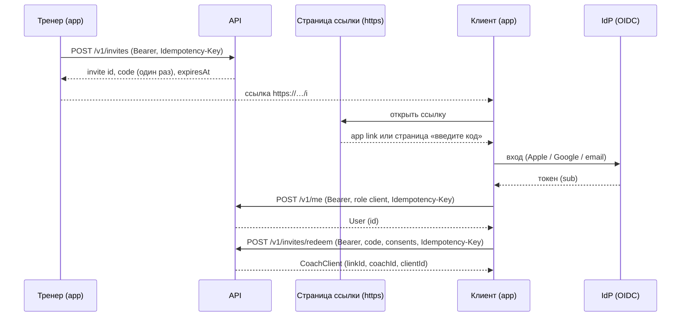

# 35. Q5: идентификаторы — передача, владение, защита

Статус: draft · Дата: 2026-11-23 · Тип: анализ, код не изменён
Основа: `CLAUDE.md` §6, §9; `docs/adr/0001-auth-adapter-local-issuer.md`; `03-nfr.md`; `12-fr-shared-admin.md` (FR-AUTH, FR-LINK); `13-business-rules.md` (BR-INVITE); `apps/api/prisma/schema.prisma`; `packages/contracts/src`; `apps/api/src` (auth, infra/idempotency, coaching, plans, identity); `apps/mobile/src/shared` (api/idempotency, session). Пометка **«предложено»** — решение авторов, не утверждённое владельцем.

## 0. Короткий ответ

- Пользователь в токене — только OIDC `sub`; API работает с внутренним `User.id` (UUID v4). В JWT нет данных о человеке. Токен — только в `Authorization: Bearer` и только в `expo-secure-store`.
- Права не выводятся из id в URL: членство в связи проверяется на каждом запросе, чужое — 404. Инвайт: код не менее 128 бит, в БД только хэш, код во fragment ссылки (предложено), до принятия — не более имени тренера.
- Дефекты, ломающие эти правила (раздел 12): `INVITE_INVALID` 400 вместо 404; идемпотентность не атомарна с записью; записи не очищаются; лимит погашения не по IP и коду; локальный issuer при `NODE_ENV=test`; нет refresh и отзыва.

## 1. Что значит «айди»

Вопрос неоднозначен, поэтому разобраны восемь смыслов: токен (разд. 2), сущности (3), `Idempotency-Key` и `requestId` (4), инвайт (5), push (7), логи и Sentry (8), экспорт и удаление (9), устройство и push-токены (10). Разделы 2–10 — по схеме «аспект / решение / если украли / тест».

## 2. Пользователь: `sub` → `authSubject` → `User.id`

| Идентификатор | Где живёт | Кто создаёт | Кто видит | Срок жизни |
|---|---|---|---|---|
| `sub` | claim JWT | IdP; локально — `POST /v1/auth/local/token` | API; клиент не должен его разбирать | токен: локально 1 ч; у IdP — по его политике |
| `User.authSubject` | `User`, unique VarChar(255) | API при создании профиля из проверенного токена | только API; нет в `UserSchema`, `PublicProfile`, экспорте | пока существует `User` |
| `User.id` | `@default(uuid())`, v4 | Postgres/Prisma | сам пользователь; контрагент по связи (`coachId`/`clientId`, `PublicProfile`); персонал — без ФИО (FR-ADM-003) | пока существует `User`; в связях после удаления — `SetNull` |

**Claims в JWT (минимум):** `iss`, `aud`, `sub`, `iat`, `exp`, `kid` в заголовке. Локальный выпуск делает ровно это (`local-token-issuer.ts`). В JWT нельзя класть: роль, имя, таймзону, email, согласия, флаги здоровья, `User.id`. Роль и профиль читаются с сервера на каждый запрос (`CurrentUser` → `requireProfile`).

**Передача и хранение:** `Authorization: Bearer <JWT>`, только HTTPS; не в query, теле и логах. Хранение только в `expo-secure-store` (копия в памяти — `session-store.ts`), не в MMKV и кэше (NFR-SEC-006).

**Refresh (FR-AUTH-004):** одна попытка при 401, затем локальный выход. В коде refresh-токена и эндпоинта нет; logout (FR-AUTH-003) ничего не отзывает на сервере. Предложено: refresh в SecureStore, ротация при каждом обновлении, повторное использование старого refresh = отзыв сессии; access-токен 15 мин.

**Кто видит какой id:**
- клиент: свой `User.id`, `linkId`, `coachId` (UUID тренера), `coachDisplayName`; `clientId` других клиентов не видит;
- тренер: `linkId`, `clientId`, имя и таймзону клиента в карточке при активном доступе; `authSubject` не видит;
- персонал: id и статусы, без ФИО и таймзоны (FR-ADM-003).

**Если украли JWT:** действует до `exp` без проверки отзыва. Смягчение — короткий TTL и отзыв refresh. **Тесты:** неверный `iss`/`aud`; `alg=none` и HS256 с ключом из JWKS; истёкший; без `sub`; `sub` длиннее 255. Ответы API не содержат `authSubject` (контрактный тест по всем ответам).

**Открытый риск — issuer.** `authSubject` уникален без `iss`. При смене вендора (ADR 0002) `sub` может измениться; в одной базе `sub` от local и prod может совпасть. Предложено: хранить пару (`iss`, `sub`).

**Риск локального режима.** `POST /v1/auth/local/token` принимает любой `subject` из тела. Защита — только `NODE_ENV ∈ {development, test}` (`config.ts`) и 120 запросов в минуту на IP. ADR 0001 требует «только локальная среда»; `test` может оказаться хостингом staging. `request.ip` без `trust proxy` (не настроен) — за прокси все клиенты делят один бакет.

## 3. Идентификаторы сущностей

Соответствие терминов и сущностей кода:
- **план** — `PlanVersion` (неизменяемые версии, `content` JSON). Ключи блоков, тренировок и упражнений — клиентские UUID внутри `content`, уникальны во всём документе (`plan.ts`).
- **тренировка** — в плане `workout.key`; в календаре — `CalendarEntry` (`id` и `workoutKey` клиентские).
- **подход** — отдельного id в контракте нет (у упражнения `sets` — число). `WorkoutLog` не реализован (К7). См. раздел 13.
- **связь** — `CoachClient`, id серверный.

**Генерация.** Серверные id — Prisma `uuid()`, v4. Клиентские — `expo-crypto.randomUUID()`, v4. Но `UuidSchema = z.uuid()` принимает любую версию, включая v1 и v7. Версия клиентских id не закреплена.

**v4 против v7:**

| Критерий | v4 | v7 |
|---|---|---|
| Локальность индекса | случайные вставки в PK `CalendarEntry.id` дают page splits | упорядочены по времени, меньше splits |
| Утечка времени | нет | мс-время создания видно каждому, кто получил id |
| Перебор | 122 бита случайности | время сужает пространство |
| Объём MVP | до 100 клиентов на тренера (NFR-LIMIT-001) | локальность при таком объёме не измерима |

Предложено: v4 для всех клиентских id в MVP (как уже в приложении); v7 — только после замера, через ADR. В контракте требовать version 4.

**Подмена и занятие чужого id.**
- `CalendarEntry.id` — глобальный PK без серверного default. Чужую запись перезаписать нельзя: `findEntry` по id; если запись из другой связи — 404; если нет — создание; гонка — unique violation → 409 `ENTRY_ID_CONFLICT`.
- Оракул: 404 (id занят в чужой связи) против 201 (свободен) показывает, существует ли id у других. С v4 это не практично; с v1 или v7 — практично. Закрывается правилом версии 4 (BL-ID-07).
- Владелец: все операции идут через `lockedCoachLink`, `findEntryOfLink(entryId, link.id)`, `deleteEntry(..., link.id)`. Чужое — 404 (проверено по коду).
- Почему id в URL не даёт прав: `:linkId`, `:clientId`, `:entryId` проверяются UUID-пайпом (malformed — 400, без обращения к БД), затем права выводятся из сессии (`User.id`) и членства в связи. Знание id без членства — 404.
- Если украли id: без токена бесполезен; с чужим токеном — 404.

**Тесты (NFR-SEC-004):** матрица «эндпоинт × чужой тренер / чужой клиент / админ» по `links/:linkId/*`, `coach/clients/:clientId/*`, `invites/:id`. Отдельно: PATCH и DELETE чужого `entryId` → 404; повтор POST того же id на тот же слот → та же запись; на другой слот → 409.

## 4. `Idempotency-Key` и `requestId`

| Аспект | `Idempotency-Key` | `X-Request-Id` |
|---|---|---|
| Назначение | повтор мутации не создаёт дубль | связь ошибки клиента с логами |
| Кто генерирует | клиент: `useIdempotencyKey` (expo-crypto v4), один ключ на намерение; сохраняется при сетевой ошибке, сбрасывается после ответа сервера | сервер: `randomUUID()` на каждый запрос (`request-context.ts`); входящий заголовок игнорируется |
| Где | заголовок на маршрутах с `IdempotencyInterceptor`: `POST /v1/invites`, `POST /v1/invites/redeem`, `POST /v1/links/:id/{pause,resume,end}`, `POST /v1/me/consents`, `POST /v1/me`, `POST /v1/coach/clients/:id/calendar`, `PUT /v1/coach/clients/:id/plan` | заголовок ответа и поле `requestId` в problem+json |
| Формат и срок | `UuidSchema` (любая версия); 24 ч (`expiresAt`) | жизнь запроса |
| Область | (`authSubject`, key); отпечаток = метод + путь + тело | — |
| Повтор после успеха | тот же статус и тело из `IdempotencyRecord`; бизнес-код не выполняется | — |
| Повтор во время выполнения | 409 `IDEMPOTENCY_CONFLICT` (не ожидание) | — |
| Повтор после ошибки | запись удаляется, операция выполняется заново | — |
| Тот же ключ, другое тело | 409 `IDEMPOTENCY_CONFLICT` | — |

Ключ и requestId не заменяют друг друга: ключ относится к бизнес-операции и хранится в БД, requestId — диагностический и не хранится.

**Если украли ключ:** доступа он не даёт; записи привязаны к `authSubject`. Но `responseBody` плана и календаря содержит данные здоровья и живёт дольше 24 ч (раздел 12, D6).

**Тесты:** два одинаковых запроса → один объект в БД (NFR-REL-006); тот же ключ и другое тело → 409; не-UUID → 400 `VALIDATION_FAILED`; два параллельных запроса → один 201, второй 409; сбой после бизнес-записи → повтор не создаёт дубль.

## 5. Код и ссылка-инвайт

**5.1 Что передаётся.** Только код: не user id, не email, не имя. Код — 26 символов Crockford base32 (130 бит поля, из них 128 бит случайности; два старших бита — нули, `invite-code.ts`). Это bearer-секрет на 7 дней: кто его знает, может привязаться к тренеру и дать согласия сам.

**5.2 Хранение.** Только SHA-256 (`hashInviteCode`), unique-индекс по `codeHash`; открытый код не попадает в БД, логи, экспорт (BR-INVITE-002). NFR-SEC-002 предлагает HMAC — расхождение (D11). При 128 битах SHA-256 достаточна; выбрать одно.

**5.3 Форма ссылки.**

| Вариант | Плюсы | Минусы | Оценка |
|---|---|---|---|
| `noexcuse://invite?code=…` (custom scheme, сейчас в `app.config.ts`) | просто | схему может перехватить другое приложение; код в query попадает в системные логи и историю | с кодом не использовать |
| https Universal Link / App Link, код во fragment `#code=` | fragment не уходит на сервер; без приложения открывается страница | нужна ассоциация домена (`apple-app-site-association`, `assetlinks.json`) | рекомендуется (предложено) |
| код в path `/i/CODE` | — | попадает в access-логи прокси и CDN | не использовать |

Посадочная страница: статическая, хостинг в ЕС, без сторонних скриптов и аналитики на странице с кодом.

**5.4 Deferred deep link (приложения ещё нет).**

| Вариант | Как | Ограничения | Оценка |
|---|---|---|---|
| A. Ручной ввод | страница: «откройте приложение и введите код» | 26 символов вручную; опечатки снижаются алфавитом Crockford | MVP (предложено) |
| B. Install Referrer (Google Play) | код в referrer при первом запуске | только Android; код проходит через Google Play | отложить, ADR |
| C. Отложенная передача через буфер или fingerprinting | — | iOS: запрос доступа к буферу; fingerprinting плохо совместим с GDPR для данных здоровья | отклонить |
| D. Сторонний attribution SDK | готовая атрибуция | новый субпроцессор, DPA и регион ЕС (NFR-PRIV-004), новая зависимость | отклонить для беты |

**5.5 Что видит клиент до принятия.** Превью в API нет. Предложено: до принятия не более `coachDisplayName`, и только через эндпоинт с тем же единым 404 и теми же лимитами по IP и коду (FR-LINK-005). Без id, таймзоны, согласий и данных о здоровье. Вариант «превью нет» проще и безопаснее; решение за владельцем (раздел 13).

**5.6 Единый ответ и лимиты.** Несуществующий, истёкший, использованный, отозванный и чужой код — один ответ 404 `INVITE_INVALID`; исключение — 429 (NFR-SEC-003). Сейчас код отдаёт 400 (D1). Погашение считается по `client.id` (5 за 10 мин), а документы требуют отдельно по IP и по коду (FR-LINK-005, NFR-LIMIT-010, D3).

**Тесты:** контракт сравнивает тела 404 для всех состояний (FR-LINK-004); два одновременных погашения одним кодом → один успех; синтетический код не находится в логах; шестой запрос с верным кодом в окне → 429.

## 6. Сквозная последовательность: ссылка → регистрация → привязка

| # | Шаг | Идентификаторы в запросе и ответе | Куда уходят и что хранится |
|---|---|---|---|
| 1 | Тренер создаёт инвайт | Bearer (`sub` → `User.id` тренера), `Idempotency-Key`; ответ: invite id, code | В БД: `codeHash`, `coachId`, `expiresAt`. Код только в ответ тренеру |
| 2 | Тренер передаёт ссылку | код во fragment | Вне API (мессенджер, почта); API не видит |
| 3 | Клиент открывает ссылку | ничего не уходит на сервер из fragment | App link передаёт код приложению; без приложения — страница |
| 4 | Вход через IdP | токен, `sub` | IdP; в API `sub` попадает при создании профиля |
| 5 | Защищённый запрос без профиля | Bearer | Ответ 403 `PROFILE_REQUIRED`. Код клиент держит в памяти или SecureStore до шага 7 |
| 6 | Создание профиля | Bearer, `Idempotency-Key`; ответ: `User.id` | В БД: `authSubject`, `User.id`, роль, имя, таймзона |
| 7 | Погашение | Bearer, код, согласия (`tos`, `health_data`, `coach_access`; `marketing` опционально), `Idempotency-Key` | В БД: `invite.usedAt`, `CoachClient` (active), согласия (сейчас без `linkId`, К1). Лимит по `client.id` (D3) |
| 8 | Ответ клиенту | `CoachClient`: `linkId`, `coachId`, `clientId` | Клиент видит `coachId`; имя тренера — в списке связей |
| 9 | Тренер видит клиента | список: `linkId`, `clientId`, `displayName` | `authSubject` тренер не видит |
| 10 | Повтор шага 7 после сбоя сети | тот же `Idempotency-Key` | Replay того же ответа, вторая связь не создаётся, если запись сохранилась (D7) |

**Точки сбоя:** неверный код — 404 (сейчас 400); два клиента одним кодом — один 201, второй 404; клиент уже с тренером — 409 `LINK_EXISTS`, инвайт не расходуется; согласие снято — `CONSENT_REQUIRED`, инвайт остаётся валидным.

**Каналы:** код — только в теле запроса погашения; токен — только в `Authorization`; `Idempotency-Key` и `X-Request-Id` — заголовки; в URL — только серверные id, никогда код или токен.

## 7. Идентификаторы в push-уведомлениях

Статус: `PushProvider`, регистрация устройства и push-токены в коде не реализованы.

Правила (предложено):
- payload только с типом события из enum (например, `plan_updated`); без имени, веса, упражнения и любых id (FR-NOTIF-002 — проверка схемой). Текст на экране блокировки общий (NFR-PRIV-001).
- приложение по нажатию открывает общий экран и запрашивает данные своим токеном через `/v1` с проверкой прав (`AccessPolicy`). Непрозрачный id даже как псевдоним не нужен: это всё ещё персональные данные.

**Если украли push-токен устройства:** можно слать уведомления (спам), данных не получить — текст общий. Срок: до logout, удаления аккаунта или 60 дней без входа (BR-DATA-005).

## 8. Идентификаторы в логах, аналитике и Sentry

Сейчас: логи — allow-list (`app-logger.ts`), пишут `requestId`, шаблон маршрута, статус и длительность; без subject и user id. Sentry в коде нет.

| Поток | Можно | Нельзя | Псевдоним |
|---|---|---|---|
| Логи API | `requestId` (серверный v4), шаблон маршрута, статус, длительность, `actorRef` | тела, токены, коды, `authSubject`, `User.id` открыто | `actorRef = HMAC-SHA256(ключ логов, User.id)`, усечённый до 16 hex; ключ в секрет-хранилище; ротация разрывает корреляцию (принято) |
| Sentry (EU) | `requestId` как тег; `actorRef` как user | `sendDefaultPii = false`; IP, email, имя, тело запроса, breadcrumbs с данными здоровья | тот же `actorRef`; удаление по нему (FR-ACCT-003) |
| Аналитика | события из схемы (NFR-PRIV-005) | любые id связей и записей, `authSubject` | случайный id установки (v4), не связан с аккаунтом, сбрасывается при выходе |

`requestId` сквозной: сервер создаёт, возвращает в заголовке и в problem+json; клиент показывает его в тексте ошибки и передаёт в поддержку. Клиентский `X-Request-Id` не принимается, это правильно.

**Тест:** синтетические JWT, код инвайта, `authSubject` и `User.id` проходят через API; в логах и в событии Sentry их нет (NFR-PRIV-002, NFR-PRIV-003).

## 9. Идентификаторы в экспорте и при удалении

**Экспорт (`AccountExport`).** Содержит `User.id`, id связей, `coachId`/`clientId`, id записей календаря, id собственных инвайтов (без кода и хэша), согласия; без `authSubject`. Id — персональные данные субъекта, их включение допустимо (FR-ACCT-002). Файл — signed URL на 24 ч, шифрование at rest.

**Удаление (FR-ACCT-003).** В одной транзакции: закрытие связей и календарь клиента, записи `IdempotencyRecord` по `subject`, строка `User` (согласия каскадом; `coachId`/`clientId`/`createdById` — `SetNull`). Не покрыто кодом: учётка в IdP (нужен admin API вендора), чужие записи идемпотентности с данными клиента (`responseBody` у тренера), события Sentry по `actorRef`, бэкапы (не позже 30 дней, BR-DATA-006).

После удаления `coachId` и `clientId` в связях обнуляются, и история не привязывается к ушедшему человеку.

## 10. Идентификатор устройства и push-токены

В коде `deviceId`, IDFV, AAID и push-токена нет. Предложено: идентификатор установки — случайный UUID v4 в SecureStore (аппаратные IDFV и ANDROID_ID не использовать: они связывают и переживают переустановку); таблица `DeviceRegistration(installationId, userId, platform, pushTokenEncrypted, lastSeenAt)`, upsert по `installationId`; срок 60 дней без входа (BR-DATA-005); удаление при logout и удалении аккаунта. Id устройства не аутентифицирует.

**Если украли:** токен позволяет слать push на устройство, данных не даёт. Отзыв — удалением строки по `installationId`.

**Тесты:** после logout и удаления строки нет; токен не попадает в логи (NFR-PRIV-002); push не содержит id.

## 11. Бэклог

| ID | Задача | Приоритет | EPIC | ADR? |
|---|---|---|---|---|
| BL-ID-01 | `INVITE_INVALID` → статус 404 (сейчас 400); контракт и тест сравнения тел | Must | EPIC-1 | нет |
| BL-ID-02 | Лимит погашения: ключи IP и код; согласовать FR-LINK-005 с NFR-LIMIT-010 (10 или 15 мин) | Must | EPIC-1 | нет |
| BL-ID-03 | Лимит создания инвайта: контракт 10/ч → 5/ч (BR-INVITE-008); согласовать с NFR-LIMIT-010 (10/сутки) | Must | EPIC-1 | нет |
| BL-ID-04 | Идемпотентность атомарно с бизнес-записью (redeem, создание инвайта) либо идемпотентный redeem по паре (invite, client) | Must | EPIC-1 | да |
| BL-ID-05 | Очистка `IdempotencyRecord` по `expiresAt` (job в worker); решение о хранении данных здоровья в `responseBody` | Must | EPIC-4 | нет |
| BL-ID-06 | Повтор `POST /v1/invites` с тем же ключом: вместо 409 — понятный ответ; исключение из NFR-REL-006 | Must | EPIC-1 | да |
| BL-ID-07 | Клиентские UUID: требовать version 4 в контракте; решение v4 или v7 | Must | EPIC-2 | да |
| BL-ID-08 | `CalendarEntry`: единый ответ на занятый id; тест оракула | Should | EPIC-2 | нет |
| BL-ID-09 | Refresh-токен, ротация, серверный отзыв при logout; TTL access 15 мин (предложено) | Must | EPIC-1 | да (вместе с 0002) |
| BL-ID-10 | Локальный issuer только при `NODE_ENV=development`; `trust proxy` для `request.ip`; уточнить ADR 0001 | Must | EPIC-1 | уточнить 0001 |
| BL-ID-11 | `authSubject` с issuer (пара `iss`, `sub`) до выбора вендора | Must | EPIC-1 | да (0002) |
| BL-ID-12 | `actorRef` (HMAC) для логов, Sentry и удаления; `sendDefaultPii = false` | Must | EPIC-4 | да |
| BL-ID-13 | Ссылка инвайта: https App/Universal Link, код во fragment, страница без логов; вариант A (ручной ввод) | Must | EPIC-1 | да |
| BL-ID-14 | Превью инвайта до входа (только имя) или отказ от превью — решение владельца | Should | EPIC-1 | нет |
| BL-ID-15 | Хэш инвайта: SHA-256 или HMAC; привести FR-LINK-001 и NFR-SEC-002 к одному | Must | EPIC-1 | нет |
| BL-ID-16 | `DeviceRegistration` и `PushProvider`; payload без id; срок 60 дней | Must | EPIC-4 | да |
| BL-ID-17 | Удаление учётки в IdP; очистка чужих записей идемпотентности с данными удаляемого | Must | EPIC-4 | да (0002) |
| BL-ID-18 | Согласия с `linkId` (К1) | Must | EPIC-1 | нет |
| BL-ID-19 | Клиентский UUID v4 на подход для `WorkoutLog` | Must | EPIC-3 | нет |
| BL-ID-20 | IDOR-матрица по всем эндпоинтам с данными клиента; malformed id — 400, чужой — 404 | Must | EPIC-4 | нет |
| BL-ID-21 | Добавить в `ERROR_CODES` `MFA_REQUIRED` и `AUTH_PROVIDER_UNAVAILABLE` (FR помечает как новые) | Must | EPIC-1 | нет |

## 12. Расхождения кода с документами (только описание)

- **D1.** `INVITE_INVALID` отдаётся со статусом 400 (`coaching.service.ts`); FR-LINK-004, NFR-SEC-003 и BR-INVITE-006 требуют 404.
- **D2.** `CONSENT_REQUIRED` отдаётся со статусом 400; FR-LINK-003 и FR-LINK-012 — 422.
- **D3.** Лимит погашения считается по `client.id`, а не по IP и коду (FR-LINK-005, NFR-LIMIT-010, BR-INVITE-009).
- **D4.** Лимит создания инвайтов: контракт 10 в час; BR-INVITE-008 и FR-LINK-002 — 5 в час; NFR-LIMIT-010 — 10 в сутки.
- **D5.** Повтор `POST /v1/invites` с тем же ключом отдаёт 409, а не исходный ответ (NFR-REL-006). Код инвайта задокументирован только в комментарии кода. Клиент, потерявший ответ, не получает код и не может его восстановить.
- **D6.** Очистки `IdempotencyRecord` по сроку нет; записи живут дольше 24 ч. `responseBody` может содержать план и календарь (данные здоровья).
- **D7.** Запись идемпотентности (`complete`) пишется после коммита бизнес-транзакции, а не в ней. Сбой между ними: при исключении запись удаляется, и повтор погашения даёт 400 `INVITE_INVALID`, хотя связь уже создана. При падении процесса запись остаётся без статуса на 24 ч, и любой повтор получает 409.
- **D8.** Локальный issuer разрешён при `NODE_ENV=test`, а ADR 0001 требует только локальную среду.
- **D9.** Нет refresh-токена, эндпоинта refresh и серверного отзыва (FR-AUTH-003, FR-AUTH-004).
- **D10.** `UuidSchema = z.uuid()` не ограничивает версию UUID, хотя CLAUDE §6 предполагает клиентский UUID (раздел 3).
- **D11.** `hashInviteCode` — SHA-256; NFR-SEC-002 предлагает HMAC с серверным ключом. `Consent` без `linkId` — К1 из `13-business-rules.md`.
- **D12.** В `ERROR_CODES` нет `MFA_REQUIRED` и `AUTH_PROVIDER_UNAVAILABLE`, которые FR помечает как новые. `authSubject` уникален без issuer (раздел 2).
- **D13.** В `apps/mobile/app.config.ts` только custom scheme `noexcuse`, ассоциации домена нет. Пробелы, не расхождения: нет Sentry, `PushProvider`, регистрации устройства, worker-очистки, `trust proxy`.

## 13. Открытые вопросы (владельцу)

1. Нужно ли превью инвайта до входа (BL-ID-14), или достаточно «введите код после входа»?
2. Что показывать тренеру, если повтор создания инвайта после сбоя сети даёт 409 и код потерян?
3. Для беты достаточно ручного ввода кода (вариант A, раздел 5.4)?
4. Клиентские UUID везде v4 (v7 — только после замера)? TTL: access 15 мин, срок refresh?
5. Вендор OIDC (ADR 0002) влияет на `sub`, удаление учётки и refresh. Кто владеет ключом `actorRef` (DPO)?
6. Нужен ли отдельный id на подход в EPIC-3 (`WorkoutLog`)? Хэш инвайта: SHA-256 или HMAC?
